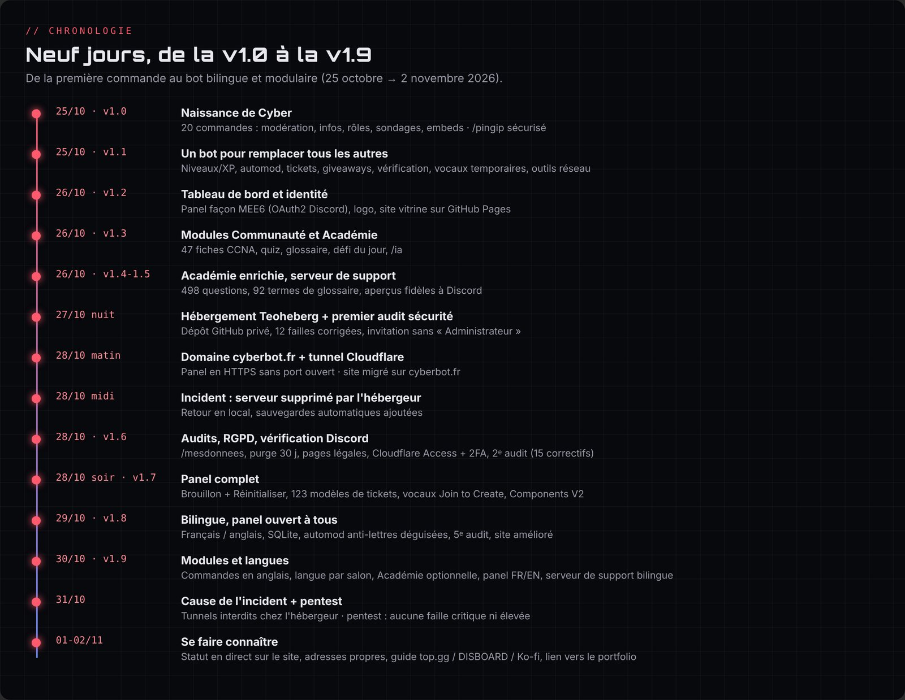

# Chapitre 1 · Contexte et objectifs

## Le point de départ

**Cyber** est un bot Discord créé par **Enzo Cerejo**, étudiant en **BTS CIEL** (Cybersécurité, Informatique et réseaux, Électronique), option Informatique et Réseaux. Le projet est né d'un constat simple : sur un serveur Discord, on empile souvent cinq ou six bots différents (un pour les tickets, un pour la modération, un pour les niveaux, un pour les giveaways…). Chacun a ses permissions, son tableau de bord, ses pannes.

L'idée : **un seul bot, gratuit, qui remplace tous les autres**. En plus, un petit module optionnel, l'**Académie**, permet de réviser les réseaux au niveau **CCNA**. Il est né de la passion d'Enzo pour l'infrastructure réseau, en lien avec sa formation.

## Les objectifs fixés

| Objectif | Ce que ça veut dire concrètement |
|---|---|
| Tout-en-un | Modération, automod, tickets, niveaux, giveaways, vérification, vocaux temporaires, rôles… |
| Modulable | Chaque serveur active seulement ce dont il a besoin (base **Communauté + Sécurité**, et des modules à installer comme l'**Académie**) |
| Pédagogique (en option) | Fiches de cours CCNA, quiz, glossaire, défi du jour, outils réseau, regroupés depuis le 30 octobre dans un module **Académie** optionnel, fait par passion |
| Simple à configurer | Un **panel web** façon MEE6 avec connexion Discord |
| Sûr | Aucun secret publié, permissions minimales, panel protégé, données personnelles maîtrisées |
| Professionnel | Site public, nom de domaine, pages légales, identité visuelle, préparation à la vérification Discord |

## La vision à long terme : les « cassettes »

Enzo a résumé sa vision ainsi : un serveur demande un module sur mesure, Enzo le développe, puis donne au serveur un **identifiant unique**. L'administrateur le saisit dans son panel (« Ajouter un module ») et Cyber installe le module, comme les cartes que l'on insère dans **Baymax** dans *Les Nouveaux Héros*.

Au moment de cette documentation, cette fonction est **annoncée « Bientôt »** dans le panel et dans la bio du bot : elle n'est pas encore codée. L'onglet « Modules publics » du panel, avec ses notes et sa recherche, est déjà prêt à les accueillir.

## Méthode de travail

Le projet a été mené avec l'assistance de **Claude (Anthropic)**, utilisé comme développeur et formateur :

- **Enzo** joue le rôle de chef de projet et d'administrateur système : il définit les besoins, teste chaque version sur ses serveurs, configure l'infrastructure (nom de domaine, DNS Cloudflare, portail développeur Discord, GitHub, hébergeur) et valide les choix de sécurité.
- **Claude** écrit le code, explique chaque notion en français, réalise les audits et rédige les guides pas à pas.

Les règles posées dès le départ :

1. Ne jamais lire, afficher ni publier le fichier `.env` (token du bot, secrets).
2. Toujours tester avant de livrer (`node src/check.js` valide toutes les commandes).
3. Garder une sauvegarde de chaque fichier modifié.
4. Expliquer simplement ce qui change et ce qu'il faut faire ensuite (relancer `DEMARRER.bat`, publier avec `PUBLIER.bat`).

## Compétences BTS CIEL mobilisées

- **Réseau** : DNS (enregistrements A, CNAME, TXT, SPF, DMARC), ports, NAT, IPv4/IPv6, tunnels, HTTPS/TLS.
- **Cybersécurité** : gestion des secrets, principe du moindre privilège, authentification multifacteur, audits, OWASP (XSS, CSRF, injections), RGPD.
- **Systèmes** : hébergement Linux en conteneur (Pterodactyl/Docker), scripts Windows (.bat), sauvegardes et restauration.
- **Développement** : Node.js, API Discord, Express, HTML/CSS/JS, Git et GitHub.
- **Gestion de projet** : versions, priorisation, documentation, relation avec un hébergeur (tickets de support).
