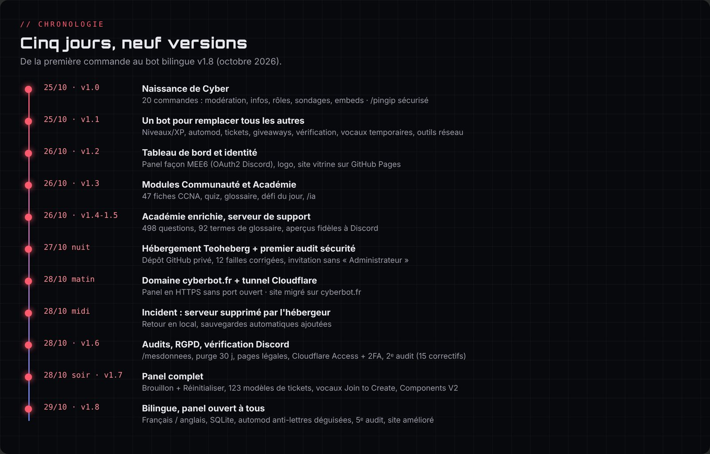
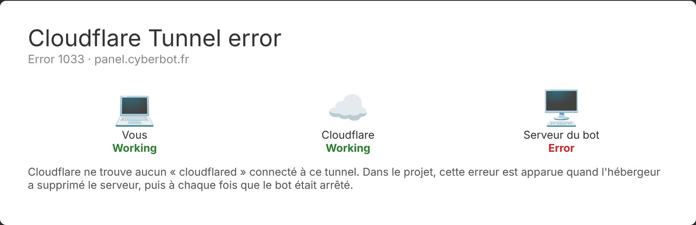

# Chapitre 2 · Carnet de bord

Ce chapitre est le compte rendu chronologique du projet : ce qui a été fait, **les problèmes rencontrés** (techniques comme humains), comment ils ont été résolus et ce que j'en ai retenu. Les heures sont en heure de Paris.

> Légende : 🛠️ réalisation · ⚠️ problème · 💡 solution ou décision · 🧠 ce que j'ai appris

---

## Jours 1 et 2 · 25 et 26 octobre : naissance de Cyber

Tout commence dans une première conversation avec Claude, intitulée « Bot Discord personnalisé ». Ma première phrase : « Tu peux m'aider à créer mon propre bot Discord ? Le code et tout ? », pour le tester sur un serveur où je suis administrateur.

### Le cahier des charges

- 🛠️ Mes premières réponses fixent le cap : des commandes utiles, de la modération, l'accueil et les rôles, des embeds, des infos sur les comptes, et, en clin d'œil au homelab, **un ping d'IP qui ne donne aucune information sensible**. Pour le langage : « choisis le plus performant pour beaucoup d'utilisation » (ce sera **Node.js avec discord.js**).
- 💡 Très vite, l'ambition grandit : « J'aimerais remplacer toutes les commandes de tous les autres bots », « je veux un max de commandes, vraiment beaucoup ». C'est la naissance de l'objectif « un seul bot à la place de MEE6, Carl-bot, Dyno et Ticket Tool ».

### Le logo

- ⚠️ *Problème humain* : je demande un logo « rouge vif pastel qui fait peur, comme le dragon de Kali Linux mais sans lui ressembler », puis « plus comme un dragon ». Claude ne génère pas d'images.
- 💡 Solution : « au pire, crée-moi un prompt et j'irai le demander à une IA spécialisée ». C'est la méthode qui servira pour tous les visuels (chapitre 10). Le logo final sera finalement un **masque de démon rouge**, que j'ai fait générer moi-même.

### Étape par étape dans le portail Discord

- ⚠️ « J'ai déjà ajouté l'app au serveur mais elle n'est pas affichée en tant que BOT. » 💡 L'application avait été invitée sans la portée `bot` : il faut générer le lien d'invitation avec les bonnes portées (`bot` et `applications.commands`).
- ⚠️ *Problème humain* : « Tu veux que j'aille sur CSC et que je te donne l'accès ? Comment faire ? Serveur MPC ? » Je ne savais pas comment laisser Claude travailler sur mon PC. 💡 Claude a écrit les fichiers lui-même dans un dossier de mon PC, puis m'a donné un seul script à lancer : **`DEMARRER.bat`**.
- ⚠️ *Problème humain et de sécurité* : j'ai collé le **token du bot** directement dans la conversation, puis refusé de le changer (« personne n'aura la conversation »). 🧠 J'ai compris plus tard qu'un secret qui a circulé doit être considéré comme compromis : tous les secrets ont été **régénérés le 28 octobre** (chapitre 8). C'est aussi de là que vient la règle n°1 du projet : le `.env` n'est jamais lu, affiché ni publié.

### Les premières versions (v1.0 et v1.1)

- 🛠️ **v1.0** : 20 commandes (modération, informations, rôles, sondages, embeds), bienvenue, rôle automatique, salon de logs. Dès le début, `/pingip` refuse les adresses privées pour ne pas pouvoir scanner mon propre réseau.
- 🛠️ **v1.1** : niveaux, automod, tickets, giveaways, vérification, vocaux temporaires, outils réseau. Je demande aussi « où se trouve précisément le dossier du bot, comment je le lance, et la liste de toutes les commandes avec ce qu'elles font ».
- ⚠️ Discord refuse `/panelroles` : une option obligatoire était placée après une option facultative. 💡 Ordre corrigé, et le script de vérification `check.js` contrôle désormais cette règle pour toutes les commandes. « Ça marche ! »
- 💡 Mes retours de testeur : je supprime `/8ball` et `/dire` (« j'aime pas »), je demande beaucoup plus de blagues et un `/userinfo` plus complet.
- ⚠️ Sur la page *Verification Qualifications* du portail, je découvre qu'il faut des conditions d'utilisation et une politique de confidentialité. 💡 On remet ça à plus tard : la vérification n'est obligatoire qu'à partir de 75 serveurs (elle sera préparée le 28, chapitre 9).

### Héberger le bot et créer le site (v1.2)

- ⚠️ *Idée reçue* : « Est-ce que je peux héberger le bot sur GitHub, comme mon portfolio ? » 💡 Non : **GitHub Pages ne sert que des pages statiques**. Il est parfait pour le site, mais le bot doit tourner sur une machine allumée en continu. Plan retenu : le site sur GitHub Pages (gratuit et sécurisé), le bot sur mon PC pour l'instant, puis sur ma propre machine plus tard.
- 🛠️ Le site vitrine voit le jour, d'abord sur `enzocerejo.github.io/cyber`, avec le logo, la bannière et le fond que j'avais préparés.
- ⚠️ Les images ne s'affichaient pas en ligne : le dossier `assets` n'avait jamais été envoyé sur GitHub, et je devais tout recopier à la main à chaque modification. 💡 Création de **`PUBLIER.bat`**, qui publie tout le dossier avec Git en un double-clic.
- ⚠️ Après une mise à jour, le navigateur affichait le nouveau HTML avec l'ancien CSS. 💡 Numéros de version « anti-cache » ajoutés automatiquement à chaque fichier.
- 🛠️ Refonte visuelle à ma demande : plus de bannière ni d'image de fond (« laisse parler ton imagination »), fond de réseau animé, titre « glitch », démonstration Discord animée. J'enlève aussi mon email du site : un contact viendra avec un nom de domaine.
- ⚠️ « Pas bien fait ici, refais bien » : une partie du site n'était qu'à moitié stylée. Puis « bug logo modo » : l'icône bouclier de la carte Modération sautait sur le bord au survol. 💡 Les deux corrigés (l'icône prenait toute la largeur de la carte).
- 💡 Ma question : pourquoi ne pas faire dès maintenant **le panel sans le serveur**, juste pour avoir le visuel prêt avant Noël ? Résultat : un **panel d'aperçu** sur le site, avec la vraie connexion Discord, des salons fictifs et un mode démo sans compte.
- ⚠️ « redirect_uri OAuth2 non valide » en cliquant sur « Se connecter avec Discord ». 💡 Deux causes : `index.html` dans l'adresse, et « Cyber » contre « cyber » (GitHub respecte les majuscules, Discord compare caractère par caractère). L'adresse est maintenant normalisée.
- 🧠 Une question honnête que j'ai posée ce soir-là : « Un bot entièrement codé par une IA peut-il vraiment être utilisé sans crainte ? » La réponse : oui, **s'il est bien suivi** : tests, audits, aucune donnée sensible, et quelqu'un qui comprend ce qui est livré. C'est ce qui a guidé la suite du projet.
- 💡 Côté matériel, je parle déjà du futur hébergement : mon père me propose d'échanger son kit Raspberry Pi 5 8 Go contre un Pi 5 2 Go. Je garde l'idée pour Noël (chapitre 7).

### Les deux modules (v1.3)

- 💡 Mon idée : « deux parties qui peuvent se cumuler ou marcher indépendamment », la partie communauté (modération, tickets…) et une partie cyber qui explique « ce que sont les pare-feu, les routeurs… vraiment très complète ». Le choix doit être « une simple case à cocher ou une commande ». Le niveau : **CCNA**, avec les trois modules du cursus (ITN, SRWE, ENSA), et une IA qui répond aux questions **tant que ça reste de l'informatique**.
- 🛠️ Résultat : les modules **Communauté** et **Académie**, 47 fiches de cours, `/quiz`, `/glossaire`, `/port`, `/osi`, `/cisco`, le défi du jour et `/ia` (limitée à 5 questions par heure et par personne).
- ⚠️ Les commandes n'apparaissaient que sur un seul serveur : elles étaient enregistrées sur un identifiant de serveur fixe. 💡 Enregistrement **automatique sur tous les serveurs** du bot, et dès qu'il en rejoint un nouveau.
- 🧠 « C'est optimisé si un jour il est sur 150 000 serveurs ? » Réponse honnête : c'est la bonne méthode pour développer, mais en production il faudra des commandes **globales**, puis le **sharding** obligatoire à partir de 2 500 serveurs et une vraie base de données (chapitre 12).

### Le choix à l'arrivée et le panel animé (v1.4)

**Lundi 26 octobre, 22 h 52** · 🛠️ Une fonction dont on avait parlé n'existait pas encore : le **choix des modules à la première invitation**. Il est créé à deux endroits : un message de bienvenue dans Discord avec trois boutons (Communauté, Académie, Les deux, réservés à ceux qui gèrent le serveur), et un écran d'accueil dans le panel. Le panel reçoit aussi des **aperçus fidèles à Discord**, un **simulateur d'automod**, des animations et une alerte en cas de modifications non enregistrées. Le **serveur de support** est relié partout (`/aide`, site, pages légales).

### Mes retours de testeur et le fichier de contexte (v1.5)

**23 h 17** · ⚠️ Je teste et je liste ce qui ne va pas : pas assez de questions dans le quiz, `/rappel` envoie **plusieurs** MP au lieu d'un, la réponse `/afk` se multiplie, et les explications (DDoS par exemple) sont trop courtes.

**23 h 19** · 💡 Le diagnostic surprend : ce n'était pas un bug des commandes. **Trois copies de Cyber tournaient en même temps** sur mon PC, parce que je relançais `DEMARRER.bat` sans fermer l'ancienne fenêtre. Chacune répondait. Le bot réserve maintenant un port local (instance unique) et `DEMARRER.bat` ferme les anciennes copies.

**23 h 48** · 🛠️ **v1.5** : 498 questions au lieu de 75 (au moins 10 par fiche), séries de 5 questions par sujet avec bilan, 47 fiches réécrites 3 à 5 fois plus détaillées, 92 termes de glossaire (DDoS détaille maintenant le botnet, les types d'attaque, l'amplification et les défenses).

- ⚠️ *Problème humain* : la conversation devenait trop longue et les réponses ralentissaient. Je demande si je peux l'exporter et la renvoyer dans une nouvelle conversation. 💡 Ça n'irait pas plus vite. La bonne solution : un fichier **`CONTEXTE-CLAUDE.md`** qui résume tout le projet (règles de sécurité, structure, recettes de publication, reste à faire), plus les outils de génération du site copiés dans le dossier du bot. Il suffit d'écrire « lis CONTEXTE-CLAUDE.md et on continue ».

🧠 Un bon fichier de contexte vaut de l'or : sans lui, il faudrait tout réexpliquer à chaque fois. Et un bug « qui se répète » n'est pas forcément dans le code : il faut d'abord vérifier combien de fois le programme tourne.

---

## Nuit du 26 au 27 octobre : premier hébergement et premier audit

**23 h 59** · Je reprends le projet avec le fichier de contexte. Le bot est en v1.5 (58 commandes) et tourne seulement quand mon PC est allumé.

**00 h 04** · 💡 Idée : utiliser **Teoheberg**, un hébergeur gratuit, pour que le bot tourne en continu et que je puisse configurer le panel avec de vraies données. J'envoie des captures des onglets Startup et Network.

**00 h 14** · 🛠️ Le bot est adapté (port de l'hébergeur, enregistrement des commandes au démarrage, script `PREPARER-TEOHEBERG.bat` qui crée un zip sans secret) avec un guide pas à pas.

**00 h 42** · ✅ « Ça a l'air de marcher tranquille. » Mais j'ai plein de questions : mon `DEMARRER.bat` sert encore à quelque chose ? Comment tu mets à jour les fichiers là-bas ? Je peux héberger le site aussi ?
💡 Réponses : `DEMARRER.bat` sert aux tests sur le PC (en éteignant l'hébergeur avant), le site reste sur GitHub Pages (gratuit, HTTPS), et pour les mises à jour, mieux vaut un **dépôt GitHub privé**.

**00 h 51** · 🛠️ Je choisis la méthode GitHub privé et je demande en même temps un audit de sécurité complet. Résultat : 4 vulnérabilités npm corrigées et **12 failles** dans le code, dont une grave : un simple membre pouvait devenir administrateur via un rôle mal configuré (détails au chapitre 8).

**01 h 23** · ⚠️ *Problème humain* : « Je mets où le token du bot sur GitHub ? »
💡 **Nulle part !** J'avais confondu deux choses : le **token du bot** (secret, seulement dans le `.env`) et le **jeton GitHub** (qui permet à l'hébergeur de lire le dépôt privé).
🧠 Il y a plusieurs « tokens » dans un projet et chacun a un rôle et un niveau de risque différent.

**01 h 24** · ⚠️ Après le premier clone sur l'hébergeur : « J'ai que ça, je fais quoi ? » 💡 C'est normal, le `.env` n'est volontairement pas sur GitHub : il faut le créer à la main sur le serveur.

**01 h 32** · ✅ Tout marche. Je veux relier le panel au site. ⚠️ Le site est en HTTPS et l'hébergeur en HTTP : les navigateurs bloquent ce mélange.

**01 h 36** · ⚠️ Le panel ne s'ouvre pas du tout (`ERR_CONNECTION_TIMED_OUT`). 💡 Diagnostic : le nom de l'hébergeur passe par Cloudflare, qui ne laisse pas passer ce port. J'ouvre un ticket au support avec un message préparé.

---

## Mercredi 28 octobre : la grosse journée

### Matin : le tunnel et le nom de domaine

**08 h 53** · ⚠️ Réponse du support : **la machine n'a aucun port entrant ouvert**. Le panel ne sera jamais joignable directement.
💡 Trois options : se passer du panel en ligne, passer à une offre payante, ou créer un **tunnel Cloudflare** (c'est le serveur qui appelle Cloudflare). Je choisis le tunnel.

**09 h 05** · Je demande si c'est sécurisé, puis si les **injections SQL** sont possibles sur le login du panel. 💡 Le tunnel est chiffré mais rend le panel public, donc il faut le protéger. Et pas d'injection SQL possible : il n'y a ni base SQL ni mot de passe.
🧠 Une faille dépend de la technologie : sans SQL, pas d'injection SQL, mais il reste le XSS, le CSRF, le vol de session…

**10 h 17** · Choix du nom de domaine. `cyber.com` est hors de portée. 💡 **cyberbot.fr** chez OVH, environ 6 €.

**10 h 38** · ⚠️ Piège évité : le **DNSSEC** activé par défaut aurait coupé le domaine au moment de passer chez Cloudflare. Je le retire avant de payer.

**10 h 47** · ✅ `cyberbot.fr` est à moi.

**10 h 52 → 11 h 03** · ⚠️ *Problème d'interface* : Cloudflare a réorganisé ses menus. Je me retrouve dans « Register domain » (acheter) au lieu d'« Onboard a domain » (ajouter), puis « Networks » n'est plus à l'endroit prévu. 💡 La recherche rapide (Ctrl + K) règle le problème. Au passage, j'ajoute SPF et DMARC contre l'usurpation de mail, et je change les serveurs DNS chez OVH.

**11 h 06** · ⚠️ Zero Trust demande une carte bancaire même pour l'offre gratuite. 💡 Rien n'est débité tant qu'on reste sur Free.

**11 h 15** · 🛠️ Tunnel créé. Je copie le token **sans jamais l'envoyer** dans la conversation.

**11 h 20** · ⚠️ « Je ne peux pas faire Next s'il n'est pas connecté… » 💡 On inverse l'ordre : d'abord le `.env` et le redémarrage, ensuite la route.

**11 h 22** · ✅ `cloudflared` tourne sur l'hébergeur, le tunnel est connecté.

**11 h 27** · ⚠️ Erreur DNS sur `panel.cyberbot.fr`. 💡 Deux causes : la route n'était pas encore ajoutée, et le domaine était encore « en attente » chez Cloudflare. Puis `ipconfig /flushdns` sur le PC, parce que Windows avait gardé en mémoire le « n'existe pas ».

**12 h 08** · ✅ Le domaine est actif.

### Midi : l'incident

**12 h 19** · ⚠️ Erreur **1033** : Cloudflare ne trouve plus aucun connecteur.

**12 h 21** · Le tunnel est « Down ».

**12 h 23** · ⚠️⚠️ « **Je n'ai plus de serveur ?** » Le serveur a été **supprimé** par l'hébergeur. Il n'apparaît plus nulle part. Les données (`data/` : niveaux, réglages) sont perdues, sauf une copie plus ancienne sur mon PC.
💡 Pas de panique : je ne recrée rien avant de connaître la raison, j'ouvre un ticket (rédigé pour l'occasion, en étant transparent sur le tunnel), et je relance le bot sur mon PC avec `DEMARRER.bat`.
🧠 Un hébergeur gratuit peut disparaître du jour au lendemain. **Sans sauvegarde, on perd tout.** C'est ce qui a déclenché les sauvegardes automatiques l'après-midi même.

**12 h 33** · Plutôt que d'attendre, on avance sur deux chantiers en parallèle : passer le site sur cyberbot.fr, et refaire l'interface du panel.

### Début d'après-midi : le site sur cyberbot.fr et le nouveau panel

**13 h 38** · 🛠️ Quatre enregistrements A vers GitHub Pages et un CNAME `www`, tous en « DNS only ». Vérification du domaine dans GitHub avec un enregistrement TXT.

**13 h 44** · ✅ « DNS check successful ». GitHub prépare le certificat HTTPS tout seul.

**13 h 47 → 14 h 04** · ⚠️ *Problème d'outil* : Claude n'arrive pas à se connecter à mon PC pour modifier les fichiers. Je ne sais pas où se trouve « Remote Control ». 💡 Finalement, je donne l'accès au dossier `Cyber` qui regroupe le bot et le site.

**13 h 55** · Question bonus : « l'interface paraît plus zoomée ». 💡 Normal : le navigateur retient un zoom par adresse, et cyberbot.fr repart à 100 %.

**14 h 07** · 🛠️ Fichier CNAME, liens mis à jour partout, `PUBLIER.bat` qui récupère d'abord les changements faits en ligne. Python n'étant pas installé sur mon PC, le build est reproduit à la main.

**14 h 20** · ✅ **Le site est en ligne sur https://cyberbot.fr.**

**12 h 33 → 15 h 53** · Refonte du panel : trois styles proposés, je choisis **« Console cyber »**. Les changements arrivent dans une **pull request**.
⚠️ *Problème humain* : on me demande « ok » à chaque étape et ça ralentit tout. 💡 Je réponds « pas besoin de ok » : désormais, les étapes réversibles se font directement (avec sauvegarde), seules les actions irréversibles me sont demandées.
⚠️ « C'est quoi fusionner la PR ? » 💡 Une PR est une proposition de modification ; « Merge » l'accepte et met le site à jour. Je fusionne la PR #1.
🧠 J'ai appris le vocabulaire Git en pratique : branche, pull request, merge, revert.

**15 h 03** · 🛠️ Ruleset GitHub sur `main` : suppression et force push interdits.

### Après-midi : l'audit global et le cadenas du panel

**15 h 06** · Je demande un audit de **tout** : sécurité, erreurs, optimisation.

**15 h 12** · Rapport : aucune fuite de secret. 1 point critique (régénérer les secrets qui étaient sur le serveur supprimé), 5 importants, 12 mineurs.

**15 h 34** · Je réponds point par point. Je choisis quoi corriger, ce qu'on fait ensemble, ce qu'on me rappellera plus tard. Pour les giveaways, je refuse une purge fixe à 30 jours (certains durent plus longtemps) : 💡 on compte maintenant **à partir de la fin** de chaque giveaway, avec une durée réglable par serveur.

**16 h 19** · 🛠️ Sauvegardes automatiques chaque jour, `RESTAURER.bat`, rappels programmés du 26 décembre au 3 janvier pour les points liés au futur serveur. Choix des sauvegardes sur **Discord plutôt que GitHub** (pas de jeton en écriture à confier au bot).

**16 h 32** · 🛠️ Alertes Dependabot et Malware activées, mais pas les mises à jour automatiques, qui auraient bloqué mes envois.

**16 h 39 → 18 h 06** · **Cloudflare Access**, la partie la plus laborieuse de la journée :
- ⚠️ Je demande si on peut ajouter une application d'authentification. 💡 Oui : MFA TOTP en plus du code par mail.
- ⚠️ **Connexion en boucle** : « That account does not have access ». La page proposait de se connecter avec mon compte Cloudflare (une autre adresse mail) alors que seule mon adresse autorisée a accès. 💡 Activer la méthode **One-time PIN** seule.
- ⚠️ Arrivée sur une page « Welcome » au lieu du panel. 💡 C'est l'App Launcher, désactivé par défaut. C'est lui qui permet d'enregistrer l'application d'authentification : il faut lui donner la même règle.
- ✅ Bitwarden enregistré. Je renomme l'équipe générée au hasard (« royal-cake-… ») en `cyberbot-team`.
- ✅ Test : mail, code et Bitwarden passent, puis erreur 1033… normale, car le bot est éteint.
🧠 La sécurité « zero trust » se configure par couches, et chaque couche a son propre écran. Il faut tester après chaque changement.

**18 h 15 → 18 h 40** · Régénération de tous les secrets et nouveau `.env` (rempli par moi, jamais montré). ✅ « Tout est fait. »

### En parallèle : où héberger Cyber pour de bon ?

**16 h 19 → 21 h** · Je me demande si un Raspberry Pi 5 est le bon choix.
⚠️ *Problème humain* : je précise que le Pi 2 Go était pour mon père et que moi je visais le 8 Go, il faut donc refaire la comparaison.
⚠️ Les premiers prix annoncés étaient **trop bas** : en 2026, la RAM a beaucoup augmenté. La correction est faite honnêtement, avec de vrais liens.
⚠️ *Contrainte de budget* : le neuf est trop cher pour un étudiant, et un PC format SFF trop encombrant.
💡 **Un mini PC reconditionné « 1 litre »** (EliteDesk Mini, ThinkCentre Tiny, OptiPlex Micro). Je compare des annonces d'occasion, et pour chacune je reçois un avis et un message prêt à envoyer au vendeur. Achat prévu à Noël, sans écran.

### Soirée : identité visuelle

**19 h 43** · 🛠️ Pack de **57 prompts** pour générer tous les visuels avec une charte stricte (palette, polices, masque de démon).
**21 h 35** · ⚠️ ChatGPT s'arrête à l'image 7 (quota gratuit). Gemini prend le relais, puis s'arrête aussi. 💡 Décision : générer un peu chaque jour, à chaque recharge des quotas. Les images sont recadrées aux bonnes tailles au fur et à mesure.
**22 h 09** · 🛠️ Avatar, bannière et description du bot posés dans le portail. Application transférée dans une équipe Discord (la 2FA est obligatoire pour ça).
**23 h 06** · ⚠️ La bannière rend mal en petite vue : du rose apparaît et le texte est coupé. 💡 L'image générée était **semi-transparente** et Discord mettait sa couleur derrière. Version opaque, texte centré.

### Soirée : vérification Discord et RGPD

**22 h 28 → 22 h 49** · 🛠️ `/mesdonnees`, effacement automatique 30 jours après le retrait d'un serveur, pages légales réécrites et mentions légales. J'ouvre et je fusionne moi-même la **PR #2**. ✅ « Tout est testé. »
**22 h 49** · Je découvre deux champs mystérieux dans le portail. 💡 Les laisser vides : l'un d'eux aurait coupé toutes les commandes.

### Soirée : le tunnel renaît depuis mon PC

**22 h 53** · « On continue sans serveur ? » 💡 Oui : le tunnel peut partir de mon PC.
**22 h 57** · ⚠️ Rien ne se passe. 💡 La ligne `TUNNEL_TOKEN` était encore **en commentaire** (`#`) dans mon `.env`. Bon point quand même : j'avais masqué mes secrets avant d'envoyer la capture.
**22 h 59** · ⚠️ Le tunnel refuse de démarrer. 💡 J'avais mis l'empreinte de la version **Linux** de `cloudflared` alors que le PC télécharge la version **Windows**. La sécurité a fait exactement son travail.
**23 h 01** · ⚠️ « Bad gateway ». 💡 La route pointait encore sur l'ancien port, et `localhost` partait en IPv6 (`::1`). Correction : `127.0.0.1:3000`.
**23 h 03** · ⚠️ *Malentendu* : « J'ai rien changé du tout, tu racontes quoi ? » Claude avait supposé que j'avais déjà modifié la route. 💡 Excuses et explication pas à pas.
🧠 Ne jamais supposer qu'une étape est faite : vérifier sur la capture avant d'affirmer.
**23 h 05** · ✅ **https://panel.cyberbot.fr fonctionne** : code par mail, code Bitwarden, connexion Discord, puis le panel.

### Fin de soirée : finitions

**23 h 07** · ⚠️ « Je n'ai toujours pas de sauvegarde dans mon salon, c'est normal ? » 💡 Non, c'était **un bug** : la sauvegarde du jour avait été créée avant que le salon soit configuré, et elle n'était plus jamais renvoyée. Corrigé.
**23 h 14 → 23 h 23** · 🛠️ Deuxième audit complet (« je veux que tout soit nickel ») : **15 petits trous corrigés**, dont la triche possible au quiz.
**23 h 17** · 🛠️ Statut permanent « 🌐 cyberbot.fr · /aide ».
**23 h 21** · 🛠️ Bio automatique avec les vrais chiffres. J'explique ma vision des modules sur mesure (« les cassettes de Baymax »), annoncée comme « Bientôt » puisqu'elle n'est pas encore codée.
**23 h 29** · 🛠️ Modèle complet du serveur Discord de support : 12 catégories, 35 salons, 15 rôles.
**23 h 48** · Je passe chaque réglage du panel en revue et je liste **7 améliorations**. Je précise en cours de route que les classements du défi doivent rester dans le salon.
**00 h 17** · ✅ **Panel v1.7 installé** : brouillon et Réinitialiser, 123 modèles de tickets, vocaux Join to Create, défi du jour privé, Components V2. 60 commandes valides.
**00 h 19** · Je confirme que Cyber a la permission Administrateur sur mon serveur, donc rien à changer pour les vocaux.

**00 h 24** · Je lance cette documentation. 📘

## Jeudi 29 octobre : Cyber s'ouvre au monde

### Cette nuit-là : la vérification des nouveaux membres

**00 h 37** · 🛠️ Le règlement du serveur de support reçoit son bouton : il donne le rôle « Membre » et retire « Non vérifié ».
**00 h 43** · ⚠️ Je vérifie : « Tu as bien fait en sorte que le rôle Non vérifié soit attribué à chaque nouveau membre, puis enlevé après vérification ? » 💡 Pas encore automatiquement : il fallait passer par le rôle automatique. Le panel le fait maintenant tout seul.
**00 h 53** · 🛠️ **Onglet Vérification du panel** : choix ou création des deux rôles, 17 modèles de règlement avec aperçu, option pour cacher les salons aux non-vérifiés. Dans la même demi-heure, la nouvelle icône du site et cette documentation sont mises en ligne.

### Matin : préparer le homelab

**10 h 29** · Question : « Proxmox et mon bot peuvent tenir ensemble sur le même PC ? » 💡 Oui, c'est le principe : Proxmox est la base, et chaque projet vit dans sa propre machine virtuelle, isolée des autres. Avec 16 Go de RAM, le bot, un bloqueur de pub et des labos BTS (pfSense, Windows Server) tiennent ensemble.

### Début d'après-midi : trois chantiers en parallèle

**13 h 44** · 💡 « Est-ce qu'on pourrait intégrer un peu d'IA dans l'automod, qui peut être contourné avec deux ou trois changements de texte ? »
**13 h 46** · ⚠️ *Problème humain* : « Combien ça me coûte ? Je ne veux pas dépenser mes tokens facilement. » 💡 L'IA du bot utiliserait une clé API séparée de mon abonnement, environ 5 centimes pour 1 000 messages.
**13 h 48** · « Restons normal pour l'instant. » 🛠️ Seule la couche gratuite est faite : l'automod démasque maintenant les lettres déguisées (alphabets étrangers, caractères invisibles, lettres stylisées, mots coupés par un symbole).
🧠 Une bonne protection gratuite d'abord, l'option payante seulement quand le besoin est prouvé.

**13 h 49** · Je demande ce qu'on pourrait améliorer sur le site. Claude propose 10 idées classées par priorité, je réponds « tout ».
**13 h 59** · 🛠️ Site amélioré (PR #6, fusionnée à 14 h 06) : page 404, plan du site pour Google (sitemap.xml et robots.txt), images en WebP (logo 26 fois plus léger), aperçu des liens partagés, section « Cyber en images », 3 nouvelles questions dans la FAQ, compteur des membres du support en direct, lien vers la documentation, accueil en anglais et page « Modules sur mesure » (annoncée comme « Bientôt »).

**14 h 03** · 💡 « C'est possible d'avoir un bot français / anglais ? Que les utilisateurs choisissent la langue, dans toutes les commandes, et n'oublie pas d'actualiser les prochaines commandes. »
⚠️ *Problème d'organisation* : la demande part d'abord dans un nouveau fil, puis revient dans le fil du panel, comme le voulait ma règle « gros changement du bot = fil du panel ». Deux messages contradictoires en une minute. 💡 Corrigé tout de suite, et la règle est maintenant appliquée sans exception.
**14 h 21** · 🛠️ **v1.8 bilingue prête** : 860 textes traduits, `/langue` pour chaque membre, `/config langue` pour le serveur, noms des commandes en anglais. ⚠️ Mais **mon PC est hors ligne** : impossible de l'installer.
**14 h 25** · 🧠 « Une PR, c'est quoi ? Et ça sert à quoi ? » Explication : une proposition de changements, relue puis fusionnée en un clic, et annulable. Conclusion : PR quand mon PC est éteint ou pour un gros changement, `PUBLIER.bat` le reste du temps.
**14 h 32** · Côté homelab, mon père achètera le mini PC choisi **samedi**, avec la transaction sécurisée de leboncoin.
**14 h 48** · ⚠️ Sur la page anglaise, il manque des onglets dans la barre du haut. 💡 Menu aligné sur la version française (PR #7, fusionnée à 15 h 03).

### Milieu d'après-midi : ouvrir le panel à tout le monde

**16 h 10** · Je cherche un hébergement pas cher jusqu'en janvier. 💡 Conseil : **Hetzner** (environ 4 € par mois, sans engagement), pas les offres « gratuites » qui m'ont déjà coûté un serveur.
**16 h 21** · Le vrai besoin apparaît : « je veux que les gens aient accès au panel de config, sécurisé, sans interruption ».
**16 h 22** · « On peut déjà créer le chemin sécurisé vers le panel pour tout le monde, sans le serveur ? » 💡 Oui : le chemin existe déjà (le tunnel). Seul le cadenas Cloudflare Access, réglé pour moi seul, bloque les autres.
**16 h 35** · « Entre le site et le panel, c'est sécurisé ? » La question part au fil d'audit, comme prévu par ma règle.
**16 h 36** · 🛠️ **Audit n°5** : un seul trou (un modérateur pouvait déplacer le salon des logs depuis le panel), et la « connexion token bizarre » de l'ancien panel d'aperçu est remplacée par un renvoi vers le vrai panel.
**16 h 38** · 💡 Décision : l'hébergeur attendra quelques jours, je veux finir l'ouverture du panel « aujourd'hui et demain ».
**16 h 39** · ⚠️ Mon PC ne répond plus (en veille). Tout est prêt mais rien ne peut être installé.
**16 h 45** · « À quoi pourrait servir une base de données ? » 💡 Solidité en cas de coupure, rapidité avec beaucoup de serveurs, sessions qui survivent aux redémarrages. **16 h 46** · « Je peux utiliser SQLite maintenant ? » 💡 Oui, avec le SQLite intégré à Node.js, donc aucun module de plus à surveiller.

### Fin d'après-midi : tout s'installe

**17 h 14** · Mon PC est de retour : « installe maintenant ».
⚠️ *Problème d'organisation* : trois fils avaient des changements prêts pour les mêmes fichiers (automod, version bilingue, audit), et le dossier du site sur mon PC était en retard sur GitHub. 💡 Un ordre d'installation précis : l'automod (un seul fichier), puis la v1.8, puis l'audit par-dessus. Chaque fois avec une sauvegarde et une comparaison avant d'écrire. Et un nouveau script, **`SYNCHRONISER-SITE.bat`**, remet le dossier du site à jour sans rien perdre, pour que `PUBLIER.bat` ne tombe pas sur un conflit.
**17 h 16** · ✅ Automod renforcé installé.
**17 h 21** · ✅ **Bot bilingue installé**. Site mis à jour (PR #8).
**17 h 28** · ✅ **SQLite et panel public installés**, testés avec la v1.8 : 61 commandes valides, données importées toutes seules.
**17 h 30** · 🛠️ Le serveur de support devient bilingue : un salon pour choisir sa langue, un règlement français et un anglais, des salons pour chaque langue.
**17 h 36** · Je fais ma part : Cloudflare Access supprimé, ancienne redirection Discord retirée, `.env` modifié. J'envoie un extrait du `.env` avec les secrets remplacés par « CACHE ». 🧠 Le bon réflexe, cette fois du premier coup.
**17 h 45** · « Quand les gens ouvrent, ça ne met pas cette page, si ? Et tu pourrais ajouter un jeu du dino comme Google, avec nos couleurs, au cas où ça prend du temps ? » 💡 Pas de copie du jeu de Google (il est protégé) : un **jeu original** où le robot Cyber saute par-dessus des bugs.
**17 h 46** · « Des cookies pour garder la connexion Discord et le classement ? » 💡 La connexion est maintenant gardée 7 jours, même après un redémarrage. Le classement mondial est déconseillé : les scores seraient trop faciles à truquer. Le record reste dans le navigateur.
**17 h 55** · ✅ Page d'attente en ligne (PR #11).
**18 h 03** · ✅ **« Ça marche bien, j'ai demandé à un pote ! »** Le panel est ouvert à tous, testé par quelqu'un d'autre que moi.
**18 h 06** · Le mini PC est choisi définitivement : un HP EliteDesk 800 G5 Mini avec 16 Go de RAM, pour 220 €.
**18 h 12** · Je demande de continuer à alimenter cette documentation avec les nouveautés. 📘

🧠 La leçon du jour : quand plusieurs chantiers avancent en même temps, le plus important n'est pas d'aller vite, c'est l'**ordre** dans lequel on installe, avec une sauvegarde à chaque étape.

---

## Vendredi 30 octobre : la v1.9, plus claire pour tout le monde

Une longue liste d'un coup, avec un mot d'ordre : « vérifie aussi toute la cohérence affichée sur le dashboard ainsi que sur le site ».

- 🧩 **L'Académie devient un module en plus**, « fait par passion », et n'est plus proposée à l'arrivée. Communauté + Sécurité sont actifs tout de suite. Le site gagne une **visite guidée animée** (Communauté → Sécurité → Modules) et une section **Modules**.
- 🌐 **Commandes en anglais pour tout le monde** (`/help`, `/learn`…), c'est plus standard. Et la **langue par salon** : un serveur peut parler français dans certains salons et anglais dans d'autres.
- 🗂️ Panel : les **sous-rubriques** de chaque onglet s'affichent dans le menu pour y aller directement, les modules sont rangés tout en haut dans un menu déroulant, et **Modules publics** sépare les modules installés de la recherche (les plus installés, les mieux notés, par nom ou par identifiant).
- 📊 Page « Choisir un serveur » plus détaillée et **boosts** dans l'aperçu.
- 📜 Règlement : un **mode avancé façon Discohook** avec plusieurs cartes colorées, titres, séparateurs et images.

Le lendemain matin, une deuxième vague :

- 🎓 « Il faut arrêter de parler du module Académie comme un module du bot par défaut. » Elle devient un petit module optionnel, fait par passion pour l'infra réseau : plus dans la bio ni dans l'accueil, et ses commandes n'apparaissent même plus dans le menu « / » des serveurs qui ne l'ont pas installée.
- 🌐 **Salons bilingues** : un bouton 🇬🇧 English / 🇫🇷 Français sous les messages de Cyber, qui change la langue du message sur place.

⚠️ *Problème* : en passant les noms de commandes en anglais, un texte qui citait plusieurs commandes sur la même ligne ne traduisait que la première. 💡 Corrigé et vérifié sur tous les textes du bot, du panel et du site.

---

## Bilan du carnet

| Indicateur | Valeur |
|---|---|
| Durée | 6 jours, dont une journée de plus de 15 heures |
| Versions | v1.0 → v1.9 |
| Commandes | 20 → 61 |
| Langues | Français et anglais |
| Audits de sécurité | 5 (plus de 45 points corrigés) |
| Pull requests sur le site | Plus de 10 |
| Incidents majeurs | 1 (serveur supprimé par l'hébergeur) |
| Données perdues | Celles du serveur hébergé (les sauvegardes automatiques existent depuis) |
