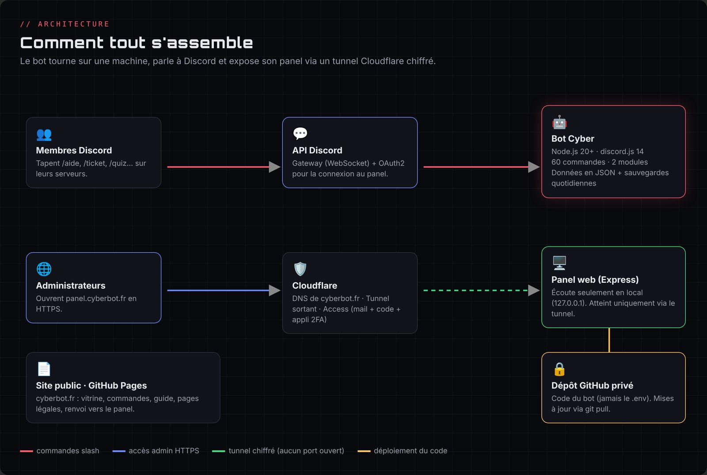
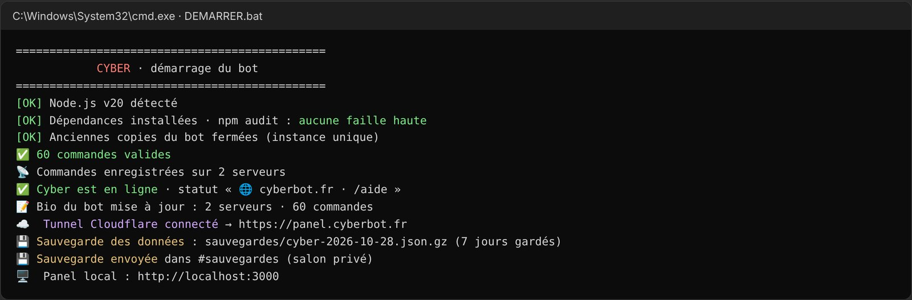

# Chapitre 3 · Choix techniques



## Les briques du projet

| Brique | Technologie | Pourquoi ce choix |
|---|---|---|
| Bot | **Node.js 24 LTS** (20 au départ) et **discord.js 14** | Bibliothèque la plus utilisée pour Discord, très documentée, gère les commandes slash, boutons, menus et Components V2 |
| Panel | **Express** (serveur web Node) + HTML/CSS/JS sans framework | Léger, tout dans le même processus que le bot, aucune dépendance lourde |
| Données | **Fichiers JSON** au départ, puis **SQLite** (`data/cyber.db`) depuis le 29 octobre | Les JSON suffisaient pour quelques serveurs. SQLite résiste mieux à une coupure en pleine écriture, ne réécrit que les lignes modifiées et garde les sessions du panel. Celui qui est intégré à Node.js n'ajoute aucune dépendance à surveiller. |
| Langues | Dictionnaire maison `src/i18n/` (français → anglais) | Traduction au moment de l'envoi : les commandes existantes n'ont presque pas changé, et `check.js` vérifie qu'aucune traduction ne manque |
| Site | **HTML/CSS/JS statique** généré par un script Python (`build.py`) | Hébergement gratuit et en HTTPS sur **GitHub Pages** |
| Domaine | **cyberbot.fr** acheté chez **OVH** | Un `.fr` pour un bot francophone, prix bas, coordonnées masquées dans le Whois pour un particulier |
| DNS, HTTPS, accès | **Cloudflare** (offre gratuite) | DNS rapide, **tunnel** sortant, **Access** (connexion par code + 2FA, utilisé pendant la phase de test) |
| Code source | **GitHub** : dépôt **public** pour le site, dépôt **privé** pour le bot | Le site n'a aucun secret ; le code du bot reste privé |
| IA (option) | API **Anthropic** (commande `/ia`) | Activée seulement si une clé API est présente, avec des limites d'usage |

## Organisation des dossiers

Sur le PC d'Enzo, tout est regroupé dans un dossier `Cyber` :

| Dossier | Contenu | Public ? |
|---|---|---|
| `bot-cyber` | Le bot, le panel, les outils (générateurs de l'Académie et du site) | **Privé** (contient le `.env`) |
| `cyber-site` | Le site vitrine et le panel de démonstration | **Public** : ce dépôt, publié sur https://cyberbot.fr |

Structure du bot :

```
src/index.js              démarrage (instance unique, événements, arrêt propre)
src/deploy-commands.js    enregistre les commandes sur tous les serveurs
src/loader.js             charge src/commands/<catégorie>/*.js
src/commands/             une commande = un fichier
src/events/               interactions, messages (automod, XP, AFK), arrivée/départ de serveur…
src/utils/                store (JSON), modules, planificateur, sécurité, sauvegardes, tunnel, bio…
src/academie/             contenu de l'Académie (fiches, quiz, glossaire) + moteur du défi du jour
src/dashboard/            serveur Express du panel (OAuth2, CSRF, CSP) + interface
src/check.js              vérifie toutes les commandes avant chaque livraison
outils/academie/          sources des textes de l'Académie + générateur
outils/site/              sources du site (*.main.html) + build.py
```

## Les scripts « un double-clic »

Enzo ne code pas : chaque opération courante tient dans un fichier `.bat` Windows.

| Script | Rôle |
|---|---|
| `DEMARRER.bat` | Vérifie Node, installe les dépendances, lance `npm audit`, enregistre les commandes, ferme les anciennes copies et démarre le bot |
| `PUBLIER.bat` | Envoie le site sur GitHub (commit, récupération des changements faits en ligne, puis push) |
| `ENVOYER-GITHUB.bat` | Envoie le code du bot sur le dépôt privé, **après avoir vérifié qu'aucun secret ni donnée ne part** |
| `RESTAURER.bat` | Restaure une sauvegarde : il suffit de glisser le fichier `.json.gz` dessus |



## Choix structurants et leurs raisons

- **Commandes enregistrées par serveur** plutôt qu'en global : elles apparaissent instantanément pendant le développement. Une option « commandes globales » est prévue pour la production.
- **Instance unique** : le bot réserve un port local. Une nouvelle copie demande à l'ancienne de s'arrêter. Ce choix corrige un vrai bug rencontré : plusieurs copies tournaient en même temps et chaque commande répondait deux fois.
- **Permissions minimales à l'invitation** : au lieu de demander « Administrateur », l'invitation liste uniquement les permissions utiles.
- **Pas de mot de passe dans le panel** : la connexion passe par Discord (OAuth2). Il n'y a donc ni mot de passe à stocker, ni base SQL à protéger.
- **Un seul panel** : au début, le site avait un panel de démonstration (le même `app.js` avec un « adaptateur » qui simulait l'API). Depuis le 29/10/2026, `cyberbot.fr/panel/` est une page d'attente qui renvoie vers le vrai panel du bot (`panel.cyberbot.fr`) ; la copie de démonstration a été retirée.
