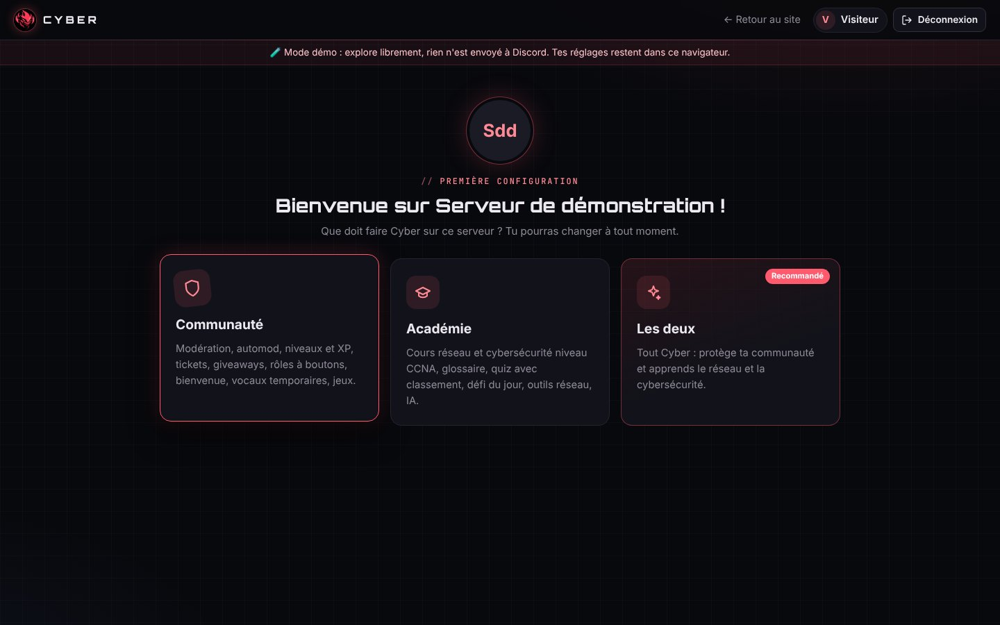

# Chapitre 4 · Le bot et ses commandes

## Évolution version par version

| Version | Date (2026) | Contenu principal |
|---|---|---|
| v1.0 | 25 octobre | 20 premières commandes : modération, informations, rôles, sondages, embeds. Bienvenue, rôle automatique, salon de logs. `/pingip` refuse les adresses privées. |
| v1.1 | 25 octobre | « De quoi remplacer tous les autres bots » : niveaux et XP, automod, tickets, giveaways, vérification anti-raid, suggestions, tags, vocaux temporaires, `/rappel`, `/afk`, `/snipe`, outils réseau, menu `/aide`. |
| v1.2 | 26 octobre | Tableau de bord façon MEE6 avec connexion Discord, nouveau logo, `/userinfo` complet, `/blague`, lancement du site. |
| v1.3 | 26 octobre | Les deux **modules** (Communauté, Académie) ; 47 fiches CCNA, `/quiz`, `/glossaire`, défi du jour, `/ia`. |
| v1.4 | 26 octobre | Choix des modules à l'arrivée sur un serveur, aperçus fidèles à Discord dans le panel, simulateur d'automod, serveur de support. |
| v1.5 | 26 octobre | Académie enrichie : 498 questions, séries de 5 par sujet, fiches réécrites, 92 termes de glossaire ; correction des réponses en double. |
| v1.6 | 27-28 octobre | Hébergement via GitHub privé, audit de sécurité, `/mesdonnees`, effacement automatique 30 jours après le retrait, sauvegardes quotidiennes, pages légales. |
| v1.7 | 28 octobre | Panel refait (brouillon + Réinitialiser, onglets Sécurité et Modules publics), bibliothèque automod, 123 modèles de tickets, vocaux « Join to Create », défi du jour privé avec classement, messages en **Components V2**. |

## Les deux modules

**Communauté** : modération, automod, niveaux et XP, tickets, giveaways, vérification anti-raid, suggestions, tags, rôles à boutons, vocaux temporaires, fun et utilitaires.

**Académie** (niveau CCNA, cursus ITN / SRWE / ENSA) :

- `/apprendre` : 47 fiches de cours détaillées, avec exemples et commandes Cisco ;
- `/quiz` : 498 questions, séries de 5 par sujet, points, séries de victoires et classement ;
- `/defi` : un quiz chaque jour dans un salon dédié, joué en privé, avec un classement publié tous les jours ;
- `/glossaire` (92 termes), `/osi`, `/port`, `/cisco` ;
- `/ia` : questions d'informatique à l'IA d'Anthropic, limitée à 5 par heure et par membre et 50 par jour et par serveur ;
- outils réseau : `/sousreseau`, `/dns`, `/convertir`, `/pingip`.

À l'arrivée sur un serveur, Cyber envoie un message d'accueil avec trois boutons : Communauté, Académie ou Les deux. Le panel pose la même question au premier passage.

## Fonctionnement interne

- **Une commande = un fichier** dans `src/commands/<catégorie>/`. Chaque fichier exporte sa définition (`data`), son exécution (`execute`) et, si besoin, la gestion de ses boutons et de son autocomplétion.
- **Routage des boutons** par préfixe : un bouton dont l'identifiant commence par `ticket:` est envoyé au fichier de la commande `/ticket`.
- **Planificateur** (`scheduler.js`) : rappels, fin des giveaways, défi du jour, sauvegardes. Un verrou empêche deux exécutions simultanées.
- **Components V2** : depuis la v1.7, un module convertit automatiquement chaque embed envoyé en conteneur Components V2, le format le plus récent de Discord, avec un repli en embed classique si le message est trop long.
- **Vérification automatique** : `node src/check.js` contrôle toutes les commandes (noms, options, limites de Discord) avant chaque livraison.

## Statut et bio automatiques

- **Statut fixe** « 🌐 cyberbot.fr · /aide », réappliqué toutes les 10 minutes et après chaque reconnexion (il remplace une rotation de 5 statuts).
- **Bio « À propos de moi » vivante** : toutes les 30 minutes, si les chiffres ont changé, le bot met à jour sa propre description avec le nombre de serveurs, de membres et de commandes (400 caractères maximum).

## Liste complète des 60 commandes

### 🧰 Utilitaires (16)

| Commande | Description | Réservée au staff |
|---|---|---|
| `/afk` | Indique que tu es absent (Cyber répond quand on te mentionne) |  |
| `/aide` | Liste de toutes les commandes de Cyber |  |
| `/avatar` | Affiche l'avatar d'un membre en grand |  |
| `/banniere` | Affiche la bannière de profil d'un membre |  |
| `/botinfo` | Informations sur le bot |  |
| `/calcul` | Calculatrice (+ - * / ^ %, sqrt, sin, cos, log, pi…) |  |
| `/emoji` | Agrandit un émoji personnalisé |  |
| `/membres` | Statistiques des membres du serveur |  |
| `/mesdonnees` (voir, effacer) | Voir ou effacer les données que Cyber garde sur toi |  |
| `/ping` | Latence du bot |  |
| `/rappel` | Cyber te rappelle quelque chose plus tard (en MP) |  |
| `/roleinfo` | Informations sur un rôle |  |
| `/serveur` | Informations sur le serveur |  |
| `/snipe` | Affiche le dernier message supprimé du salon | oui |
| `/sondage` | Crée un sondage avec réactions |  |
| `/userinfo` | Informations détaillées sur un compte |  |

### 🎓 Académie (8)

| Commande | Description | Réservée au staff |
|---|---|---|
| `/apprendre` | Fiche de cours réseau / cybersécurité (niveau CCNA) |  |
| `/cisco` | Mémo des commandes Cisco IOS |  |
| `/defi` (activer, desactiver, maintenant) | Défi du jour : un quiz réseau / cyber chaque jour, avec classement | oui |
| `/glossaire` | Définition détaillée d'un terme réseau / cybersécurité |  |
| `/ia` | Pose une question d'informatique à l'IA de Cyber |  |
| `/osi` | Le modèle OSI, couche par couche |  |
| `/port` | Quel service utilise ce port ? (ou l'inverse) |  |
| `/quiz` (jouer, classement, stats) | Quiz réseau / cybersécurité niveau CCNA |  |

### 🌐 Outils réseau (4)

| Commande | Description | Réservée au staff |
|---|---|---|
| `/convertir` | Convertit un nombre (décimal, binaire, hexa, octal) |  |
| `/dns` | Interroge le DNS d'un nom de domaine public |  |
| `/pingip` | Ping une adresse IP publique ou un nom de domaine |  |
| `/sousreseau` | Calculateur de sous-réseau IPv4 |  |

### 📈 Niveaux (4)

| Commande | Description | Réservée au staff |
|---|---|---|
| `/classement` | Top 10 des membres les plus actifs |  |
| `/rang` | Ton niveau et ton XP |  |
| `/recompense` (ajouter, retirer, liste) | Rôles donnés automatiquement à un niveau | oui |
| `/xp` (ajouter, retirer, reset) | Gérer l'XP des membres | oui |

### ⚙️ Systèmes (7)

| Commande | Description | Réservée au staff |
|---|---|---|
| `/automod` (activer, filtre, mot, autoriser, exempter, sanction, voir) | Modération automatique | oui |
| `/giveaway` (lancer, terminer, reroll) | Concours avec tirage au sort | oui |
| `/suggestion` | Propose une idée pour le serveur |  |
| `/tag` (voir, creer, supprimer, liste) | Réponses enregistrées (règles, liens, FAQ…) |  |
| `/ticket` (panel, fermer, ajouter, retirer) | Système de tickets de support |  |
| `/verification` | Panneau de vérification anti-bots (bouton qui donne un rôle) | oui |
| `/vocal` (renommer, limite, statut, panneau) | Règle ton salon vocal temporaire |  |

### 🛡️ Modération (9)

| Commande | Description | Réservée au staff |
|---|---|---|
| `/ban` | Bannit un utilisateur | oui |
| `/clear` | Supprime des messages dans ce salon | oui |
| `/kick` | Expulse un membre | oui |
| `/mute` | Rend un membre muet temporairement (timeout) | oui |
| `/pseudo` | Change le pseudo d'un membre sur le serveur | oui |
| `/salon` (verrouiller, deverrouiller, slowmode) | Gestion du salon actuel | oui |
| `/unban` | Débannit un utilisateur via son ID | oui |
| `/unmute` | Retire le mute d'un membre | oui |
| `/warn` (ajouter, liste, effacer) | Gestion des avertissements | oui |

### 🎭 Rôles (2)

| Commande | Description | Réservée au staff |
|---|---|---|
| `/panelroles` | Crée un panneau où les membres choisissent leurs rôles avec des boutons | oui |
| `/role` (donner, retirer) | Donner ou retirer un rôle | oui |

### 🎲 Fun (7)

| Commande | Description | Réservée au staff |
|---|---|---|
| `/blague` | Une blague ou une devinette au hasard |  |
| `/choisir` | Choisit au hasard parmi plusieurs options |  |
| `/compatibilite` | Taux de compatibilité entre deux membres |  |
| `/de` | Lance un ou plusieurs dés |  |
| `/note` | Cyber note n'importe quoi sur 10 |  |
| `/pfc` | Pierre, feuille, ciseaux contre Cyber |  |
| `/pileouface` | Lance une pièce |  |

### 🔧 Admin (3)

| Commande | Description | Réservée au staff |
|---|---|---|
| `/config` (bienvenue, logs, autorole, niveaux, vocal, suggestions, giveaways, voir) | Configuration du bot sur ce serveur | oui |
| `/embed` | Crée un message embed personnalisé (annonce, règlement…) | oui |
| `/modules` | Activer ou désactiver les modules de Cyber sur ce serveur | oui |
