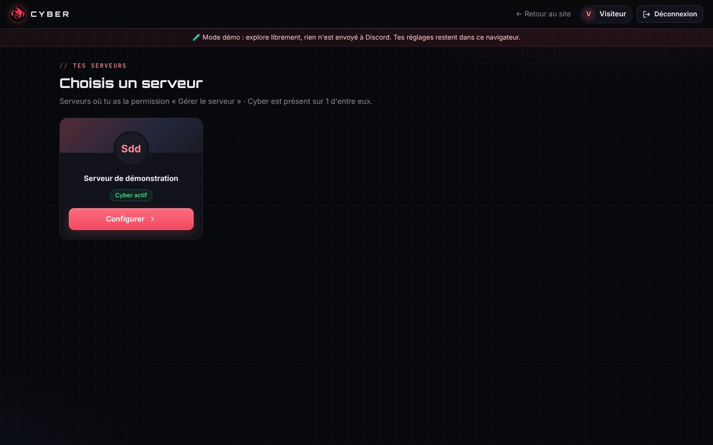
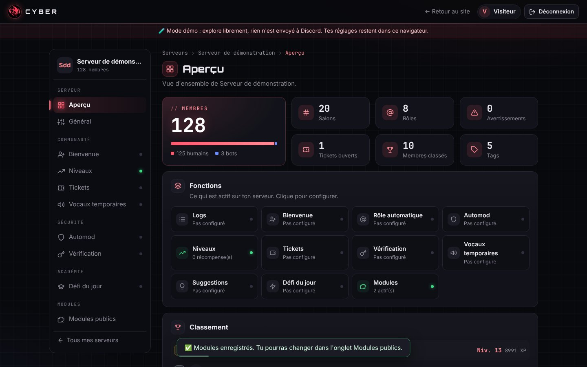
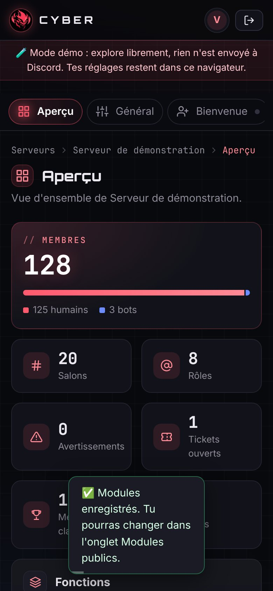
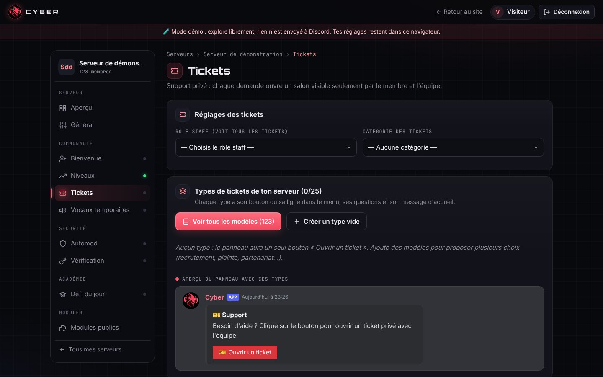
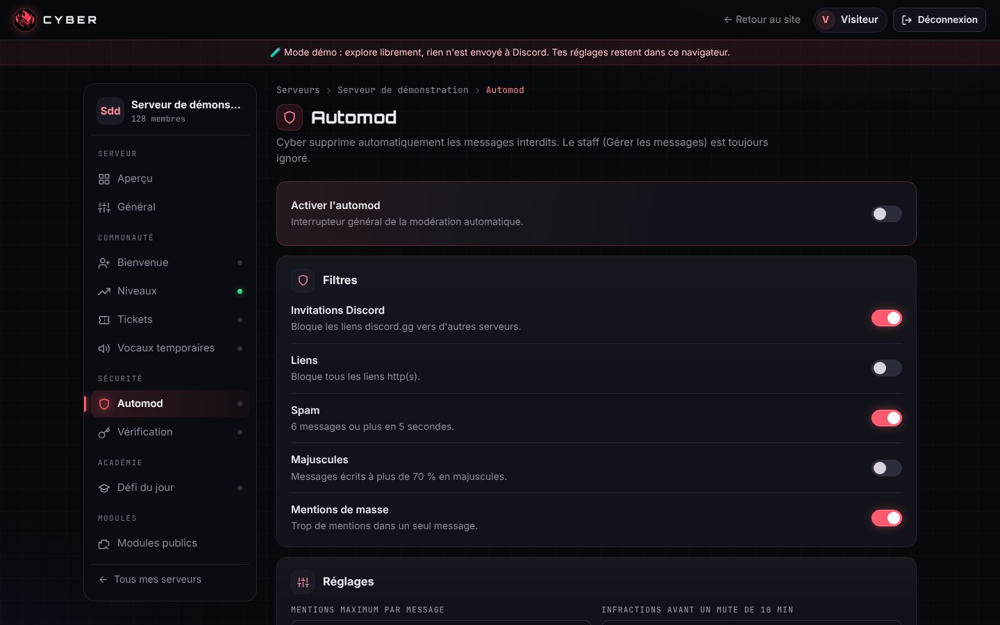
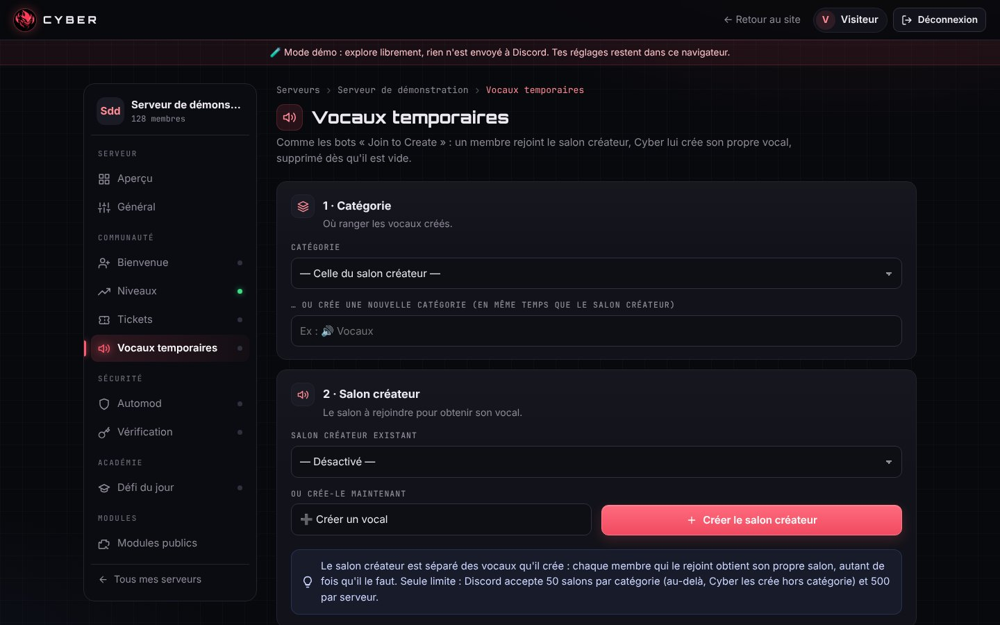
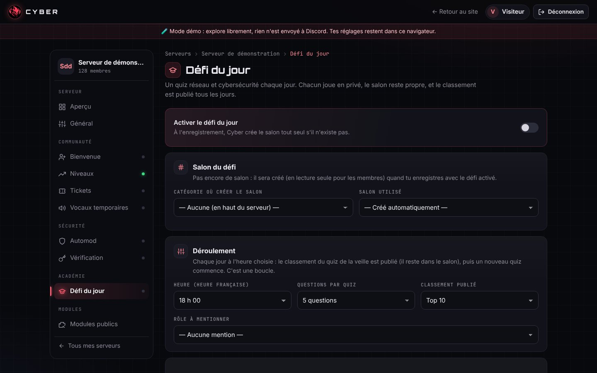
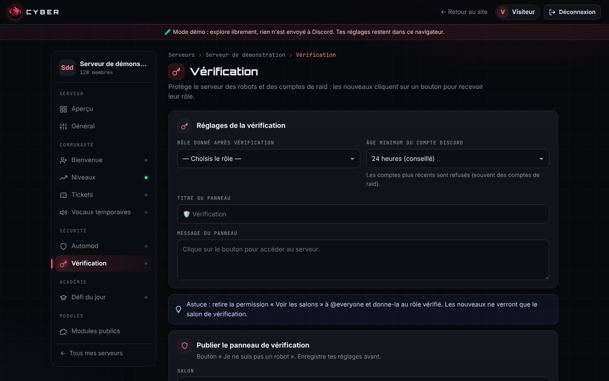
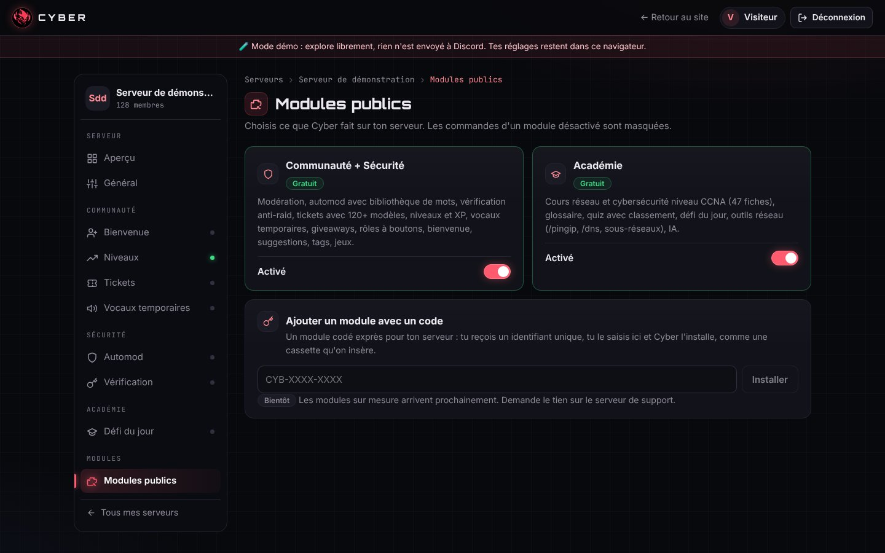

# Chapitre 5 · Le panel d'administration

Le panel est un site web intégré au bot qui permet de tout régler sans taper de commande. On s'y connecte avec son compte Discord, puis on choisit un serveur dont on a la permission « Gérer le serveur ».

Une **version de démonstration** est disponible sur le site public : https://cyberbot.fr/panel/ (bouton « Essayer sans compte »). Elle utilise le même code que le vrai panel, mais les réglages restent dans le navigateur et rien n'est envoyé à Discord. Toutes les captures de ce chapitre viennent de ce mode démo.

## Étape 1 · Premier panel (v1.2 à v1.4)

- Connexion **Discord OAuth2**, réglages en quelques clics, aperçu des messages en direct.
- Onglets par fonction : bienvenue, niveaux, tickets, automod, vérification, Académie…
- **Aperçus fidèles à Discord** : on voit le message de bienvenue, le passage de niveau ou le panneau de tickets exactement comme il apparaîtra.
- **Simulateur d'automod** : on teste un message avant d'enregistrer ses règles.

## Étape 2 · Refonte « Console cyber » (28 octobre)

Trois styles ont été proposés à Enzo : « Console cyber », « Moderne épuré » ou « Garder et polir ». Il a choisi **Console cyber**, qui colle à l'identité du bot (rouge, masque de démon, univers réseau).

Ce qui a changé :

- barre latérale pleine hauteur, rangée en groupes (Serveur, Communauté, Sécurité, Académie, Modules), avec des icônes et un point vert sur ce qui est déjà configuré ;
- page d'aperçu avec une grande carte Membres et des modules cliquables ;
- version mobile : les onglets deviennent une barre qui défile ;
- la refonte a d'abord été proposée sur une branche du site (**pull request #1**), testée en mode démo sur ordinateur et téléphone, puis fusionnée.

## Étape 3 · Panel v1.7 : les 7 lots demandés par Enzo

Après avoir parcouru chaque réglage, Enzo a listé ce qui manquait. Tout a été livré en une soirée, en 7 lots :

| Lot | Demande d'Enzo | Résultat |
|---|---|---|
| 1 | Pouvoir changer d'onglet sans enregistrer, et un bouton Réinitialiser « comme sur Discord » | Les onglets modifient un **brouillon**. Une barre fixe « Réinitialiser / Enregistrer les modifications » apparaît dès qu'on change quelque chose. Quitter avec des modifications fait trembler la barre. Seuls les réglages modifiés sont envoyés. |
| 2 | Séparer tickets et vérification, créer des onglets Communauté / Sécurité / Modules publics | Nouvelle navigation : Serveur, Communauté, Sécurité, Académie, Modules publics. |
| 3 | Une bibliothèque de mots interdits avec leurs variantes, et des mots autorisés | Environ 250 mots classés (insultes, haine, harcèlement, arnaques…) détectés même déguisés (`c0nn4rd`, `c.o.n.n.a.r.d`), plus une liste blanche. |
| 4 | Des centaines de modèles de tickets prêts à l'emploi | **123 modèles** en 12 catégories (recrutement, plainte, partenariat, boutique, jeux, roleplay…), modifiables, avec jusqu'à 5 questions posées à l'ouverture et un bouton « Prendre en charge ». |
| 5 | Des vocaux temporaires automatisés | Système « Join to Create » : salon créateur installé en un clic, options par défaut, panneau `/vocal` pour renommer, limiter, verrouiller, masquer, définir un statut… |
| 6 | Un défi du jour dans un salon créé automatiquement, joué en privé, avec un top 5 ou 10 | Le salon est créé à l'enregistrement. Chaque membre répond en messages **éphémères** (visibles par lui seul). À l'heure choisie, le classement est publié et **reste dans le salon**, puis un nouveau quiz commence. |
| 7 | Tous les messages au format « Embeds V2 » | Conversion automatique de tous les messages en Components V2. |

## Sécurité du panel

Le panel n'a ni mot de passe ni base SQL : **aucune injection SQL n'est possible**. Les protections en place :

- connexion Discord OAuth2 avec paramètre `state` contre les attaques CSRF ;
- cookie de session `HttpOnly`, `SameSite=Lax`, et `Secure` en HTTPS ;
- textes affichés avec `textContent` ou échappés (contre le XSS) et politique **CSP** `script-src 'self'` ;
- en-tête personnalisé et contrôle de l'origine sur toutes les requêtes qui modifient quelque chose ;
- permission « Gérer le serveur » revérifiée en direct à chaque requête ;
- limite de requêtes par adresse IP (la vraie IP est lue derrière le tunnel Cloudflare) ;
- **HSTS** dès que le panel est en HTTPS ;
- le panel n'écoute que sur `127.0.0.1` : il n'est jamais exposé en HTTP simple sur Internet.

Le détail de l'accès par tunnel et de Cloudflare Access est au chapitre 7.
