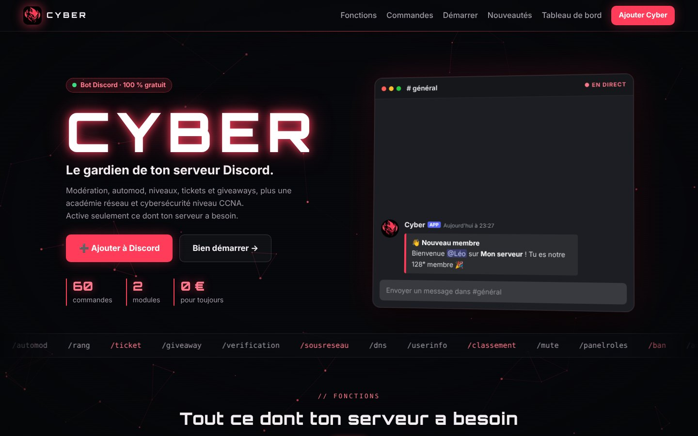
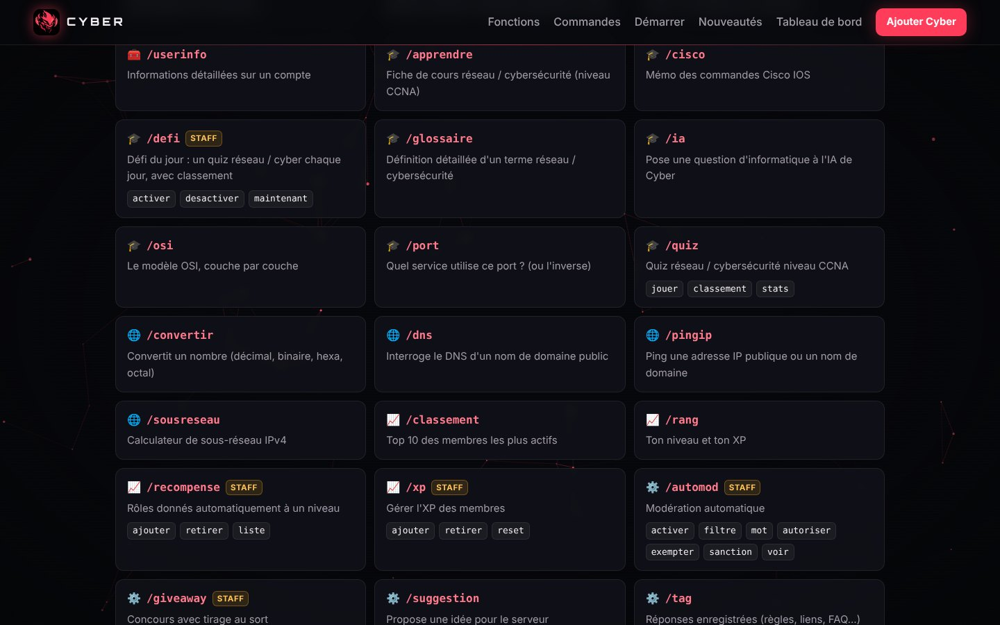
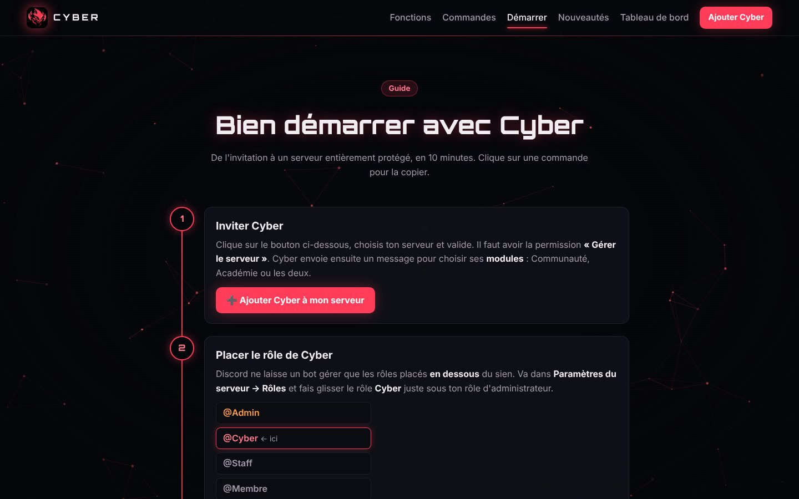
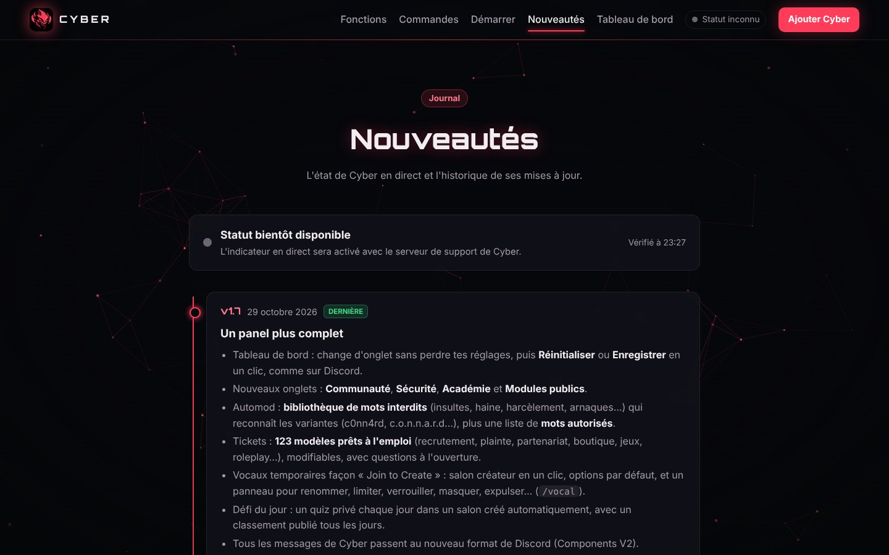
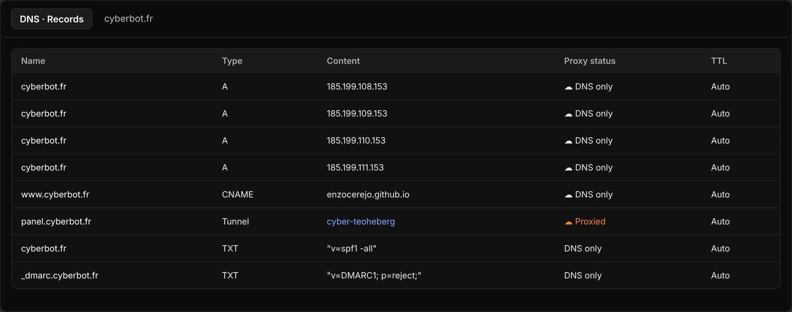
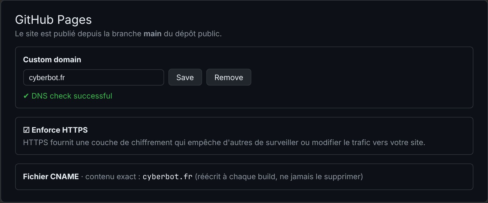

# Chapitre 6 · Le site et le domaine cyberbot.fr

## Le site vitrine

Le site présente Cyber, liste ses commandes, explique comment démarrer et publie l'historique des versions. Il est hébergé gratuitement par **GitHub Pages**, en HTTPS.

| Page | Contenu |
|---|---|
| Accueil | Présentation, fonctions, liste des commandes avec recherche, FAQ |
| Bien démarrer | Guide pas à pas après l'invitation du bot |
| Nouveautés | Statut et historique des versions |
| Conditions, Confidentialité, Mentions légales | Pages légales (voir chapitre 9) |
| Panel | Démonstration du tableau de bord sans compte |

### Comment le site est fabriqué

1. Les pages sont écrites dans le dossier du bot, sous `outils/site/<page>.main.html`.
2. Le script `build.py` ajoute l'en-tête, le pied de page et des numéros de version « anti-cache », puis écrit les pages dans le dossier du site. Il réécrit aussi le fichier `CNAME`.
3. `commandes.js` est **généré à partir du code du bot** : la liste du site est donc toujours à jour.
4. `PUBLIER.bat` envoie le tout sur GitHub. Le site est en ligne 1 à 2 minutes plus tard.

Les polices (Orbitron, Inter) sont hébergées sur le site lui-même pour ne rien envoyer à Google.

## Achat du nom de domaine (28 octobre)

Les noms `cyber.com` ou `cyberbot.com` étant presque sûrement pris ou très chers, le choix s'est porté sur **cyberbot.fr** :

- acheté chez **OVH** pour environ 6 € la première année ;
- sans option payante (pas d'e-mail, pas de DNS Anycast) ;
- **DNSSEC retiré** à l'achat pour éviter une panne au moment du transfert des DNS vers Cloudflare (il pourra être réactivé côté Cloudflare) ;
- renouvellement automatique activé ;
- pour un particulier, le `.fr` masque le nom et l'adresse dans l'annuaire public (Whois).

## Passage des DNS sur Cloudflare

1. Ajout du domaine dans Cloudflare (offre **Free**), avec le blocage des robots d'entraînement d'IA activé.
2. Chez OVH : « Utiliser mes propres DNS », avec les deux serveurs de noms fournis par Cloudflare.
3. Ajout de deux enregistrements anti-usurpation, puisque aucun e-mail n'est envoyé avec `@cyberbot.fr` :
   - `TXT @ "v=spf1 -all"` : aucun serveur n'a le droit d'envoyer de mail pour ce domaine ;
   - `TXT _dmarc "v=DMARC1; p=reject;"` : les faux mails doivent être rejetés.
4. Activation du domaine en moins d'une heure.

## Le site passe de github.io à cyberbot.fr

1. Quatre enregistrements **A** vers les serveurs de GitHub Pages et un **CNAME** `www` vers `enzocerejo.github.io`, tous en **DNS only** (nuage gris) : sinon GitHub ne peut pas créer le certificat HTTPS.
2. Vérification du domaine dans GitHub (enregistrement `TXT _github-pages-challenge-…`).
3. Domaine personnalisé ajouté au dépôt, puis **Enforce HTTPS** coché une fois le certificat créé.
4. Côté code : fichier `CNAME` ajouté et protégé (réécrit à chaque build), tous les liens remplacés, `PUBLIER.bat` amélioré pour récupérer d'abord les modifications faites en ligne avant d'envoyer.

## Protéger la branche principale

Un **ruleset GitHub** protège la branche `main` du site : suppression interdite et « force push » bloqué. Les pull requests ne sont pas obligatoires pour que `PUBLIER.bat` puisse continuer à publier directement.

## Les pull requests du site

| PR | Contenu |
|---|---|
| #1 | Nouvelle interface « Console cyber » du panel de démonstration |
| #2 | Pages légales réécrites, mentions légales, `/mesdonnees` dans la liste des commandes |
| #3 | Cette documentation |
