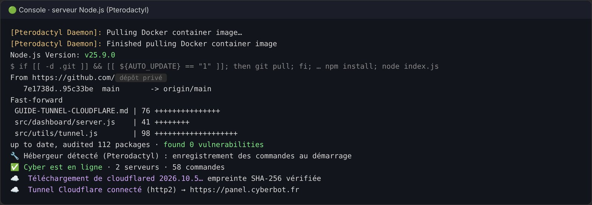
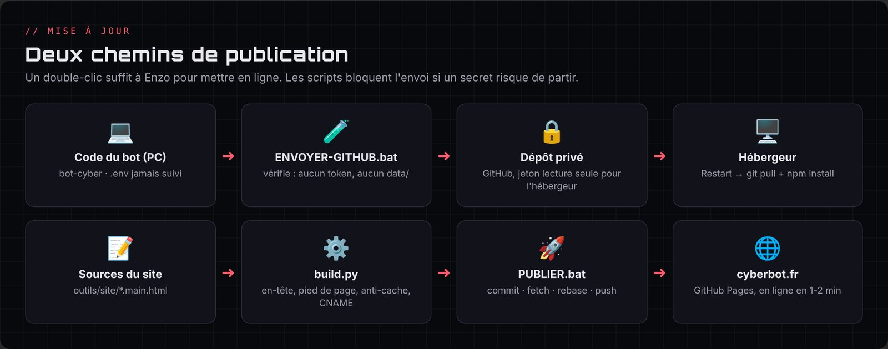
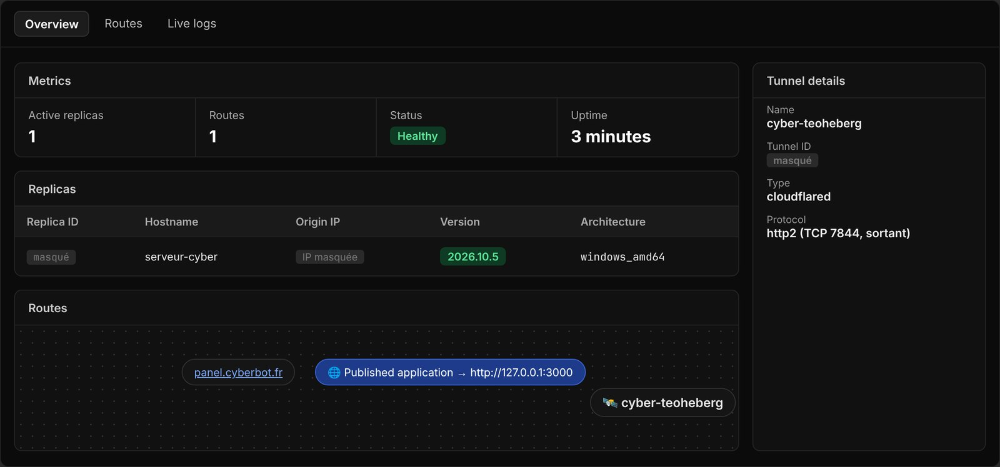
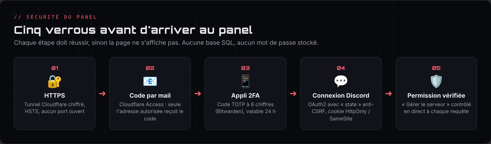

# Chapitre 7 · Hébergement, GitHub privé et tunnel Cloudflare

Ce chapitre raconte le chemin le plus « réseau » du projet : faire tourner le bot 24 h/24, puis rendre son panel accessible en HTTPS **sans ouvrir un seul port**.

## Étape 1 · Un hébergeur provisoire (26 octobre)

En attendant une machine personnelle, le bot est installé chez **Teoheberg**, un hébergeur gratuit à crédits basé sur **Pterodactyl** (chaque serveur est un conteneur Docker).

Adaptations faites dans le code :

- un fichier `index.js` à la racine qui lance `src/index.js` (le panel de l'hébergeur lance `index.js`) ;
- détection automatique de Pterodactyl : le panel écoute sur le port attribué et les commandes s'enregistrent au démarrage (il n'y a pas de `DEMARRER.bat` là-bas) ;
- compatibilité Node 25 vérifiée ; sur le PC, rien ne change.

Règle importante découverte en route : **ne jamais lancer le bot sur le PC et sur l'hébergeur en même temps**, sinon chaque commande reçoit deux réponses.

## Étape 2 · Mises à jour par un dépôt GitHub privé

Au lieu d'envoyer un zip à chaque modification :

1. Enzo crée un dépôt **privé** sur GitHub.
2. `ENVOYER-GITHUB.bat` envoie le code, **en refusant** de partir si un secret ou le dossier `data/` risque d'être inclus. Le `.gitignore` exclut `.env`, `data/`, `node_modules/` et les zips.
3. L'hébergeur lit le dépôt avec un **jeton GitHub « fine-grained » en lecture seule**, limité à ce seul dépôt.
4. Avec l'option « auto update », un simple **Restart** fait `git pull`, `npm install` puis relance le bot.

Le `.env` (token du bot, secrets) n'est jamais sur GitHub : il est créé à la main dans le gestionnaire de fichiers de l'hébergeur.

## Étape 3 · Le panel injoignable

Le bot fonctionnait, mais l'adresse du panel donnait `ERR_CONNECTION_TIMED_OUT`. Diagnostic en deux temps :

1. Le nom de l'hébergeur passait par **Cloudflare**, qui ne relaie que les ports web classiques (80, 443…), pas le port attribué.
2. Le support a ensuite confirmé que **la machine n'avait aucun port entrant ouvert**.

Le bot, lui, marchait parce que c'est **lui qui se connecte** à Discord (connexion sortante). C'est cette idée qui donne la solution.

## Étape 4 · Le tunnel Cloudflare

Un **tunnel Cloudflare** inverse le sens de la connexion : c'est le serveur qui appelle Cloudflare, et Cloudflare renvoie ensuite les visiteurs de `panel.cyberbot.fr` vers lui. Résultat : HTTPS, adresse IP cachée, et **aucun port à ouvrir**.

Ce qui a été codé (`src/utils/tunnel.js`) :

- si `TUNNEL_TOKEN` est présent dans le `.env`, le bot télécharge le programme officiel `cloudflared` et le lance ;
- connexion en `http2` sur le port TCP 7844 sortant ;
- `cloudflared` reçoit un environnement minimal : il ne voit pas le token Discord ;
- il est relancé automatiquement s'il tombe ;
- son **empreinte SHA-256** est retenue au premier téléchargement et vérifiée à chaque lancement (et peut être fixée sur la valeur officielle publiée par Cloudflare) ;
- le panel n'écoute alors plus que sur `127.0.0.1`.

Côté Cloudflare : création du tunnel `cyber-teoheberg`, puis d'une route publique `panel.cyberbot.fr` vers le service local du panel.

### Deux pièges rencontrés et résolus

- **Mauvaise empreinte** : le `.env` du PC contenait l'empreinte de la version **Linux** de `cloudflared` alors que le PC télécharge la version **Windows**. La sécurité a bloqué le lancement, exactement comme prévu. Il a suffi de mettre l'empreinte officielle de la version Windows.
- **`localhost` vers IPv6** : sur Windows, `localhost` a été traduit en `::1` (IPv6) alors que le panel n'écoute qu'en IPv4. La route a été corrigée en **`http://127.0.0.1:3000`**, et l'erreur « Bad gateway » a disparu.

## Étape 5 · Cloudflare Access : un cadenas devant le panel

Même en HTTPS, une adresse publique peut être visitée par n'importe qui. **Cloudflare Access** (gratuit) ajoute une vérification avant même d'afficher le panel :

1. application « Panel Cyber » sur `panel.cyberbot.fr`, session de 24 h ;
2. règle « Moi » : **Allow** uniquement pour l'adresse e-mail d'Enzo ;
3. méthode de connexion **One-time PIN** seule (code reçu par mail), avec « instant authentication » ;
4. **MFA** : un code TOTP à 6 chiffres depuis une application d'authentification (Bitwarden), en plus du code par mail ;
5. nom d'équipe personnalisé pour la page de connexion.

Cloudflare répond de la même façon que l'adresse tapée soit autorisée ou non : personne ne peut deviner laquelle est sur la liste.

> **29 octobre** : ce cadenas a joué son rôle pendant la phase de test. Pour que tout le monde puisse configurer Cyber, l'application Access a été **supprimée** après un audit du panel (chapitre 8, audit n°5). La sécurité repose désormais sur la connexion Discord du panel et sur la permission « Gérer le serveur », revérifiée à chaque requête. L'application peut être recréée en deux minutes si besoin.

## Étape 6 · Le tunnel depuis le PC

Après la suppression du serveur de l'hébergeur (voir chapitre 11), le même tunnel a été relancé **depuis le PC d'Enzo**, simplement en modifiant la route vers `127.0.0.1:3000`. Le panel est accessible sur `https://panel.cyberbot.fr` tant que le PC et le bot sont allumés. Pour un futur serveur, il suffira de copier le `.env` avec l'empreinte adaptée et de pointer la route sur `127.0.0.1:<port>`.

## Le futur hébergement : un mini PC « homelab »

Comparaison faite pour un hébergement à la maison :

| Critère | Raspberry Pi 5 (8 Go) | Mini PC reconditionné (format 1 litre) |
|---|---|---|
| Prix observé fin 2026 | ≈ 230 € en kit | ≈ 150-220 € d'occasion, ≈ 300-350 € en reconditionné pro |
| Processeur | ARM | x86 (i5 8ᵉ/9ᵉ génération) |
| Stockage | microSD ou SSD avec carte en plus | SSD NVMe inclus |
| Virtualisation | Très limitée | Proxmox, plusieurs VM (pfSense, Windows Server, labos) |
| Compatibilité Docker | La plupart des images | Toutes |

Conclusion retenue : un **mini PC reconditionné** (HP EliteDesk 800 G4/G5 Mini, Lenovo ThinkCentre M720q/M920q, Dell OptiPlex 7070 Micro) avec Proxmox ou Debian, Docker et le tunnel Cloudflare déjà prêt. Il servira aussi de laboratoire pour le BTS CIEL et le CCNA. Choix final (29 octobre) : un **HP EliteDesk 800 G5 Mini** d'occasion (i5-9500 6 cœurs, **16 Go** de RAM, SSD 500 Go, Wi-Fi) à **220 €**, préféré à un modèle à 200 € qui n'avait que 12 Go. Mon père l'achète le samedi 31 octobre avec la transaction sécurisée de leboncoin. Prévu ensuite : **Proxmox**, une VM Debian avec Docker pour le bot, le panel et le tunnel, puis des VM de labo (pfSense, Windows Server, Linux) allumées seulement pour réviser.

## Et en attendant ?

Le 29 octobre, j'ai aussi étudié un hébergement payant pour que le panel reste disponible même quand mon PC est éteint :

| Option | Prix | Avis |
|---|---|---|
| **Hetzner Cloud CX23** (2 vCPU, 4 Go) | ≈ 4 €/mois, facturé à l'heure | Recommandé : fiable, sans engagement, bots et tunnels autorisés |
| Oracle Cloud « Always Free » | Gratuit | Offre réduite en 2026, carte bancaire, serveur arrêté sans prévenir s'il travaille peu |
| OVHcloud VPS-1 | ≈ 7,79 €/mois | Plus confortable mais plus cher pour 2 ou 3 mois |
| Hébergeurs « gratuits spécial bots » | « Gratuit » | Écartés : c'est le genre qui a supprimé mon serveur |

Décision : rester sur le PC pour l'instant (le panel est disponible quand il est allumé) et décider dans quelques jours. Le tunnel ne changera pas : il suffira de le lancer depuis la nouvelle machine.
