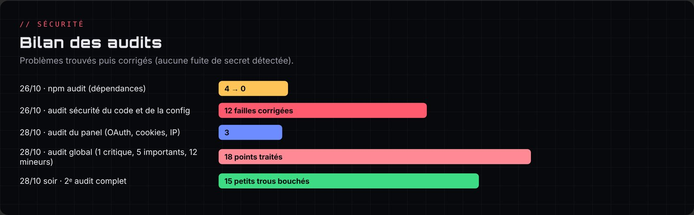

# Chapitre 8 · Sécurité et audits

La sécurité a été traitée comme un fil rouge : quatre audits en trois jours, chaque fois avec un rapport classé par priorité, une explication simple de chaque faille, puis les corrections testées.

## Les règles de base

- **Le `.env` ne quitte jamais la machine** : il contient le token du bot, le secret OAuth2, le token du tunnel et la clé d'API. Il est exclu par `.gitignore` et les scripts d'envoi bloquent tout ce qui ressemble à un secret.
- **Dépôt du bot privé**, dépôt du site public mais sans aucun secret.
- **Moindre privilège** partout : invitation sans « Administrateur », jeton GitHub en lecture seule sur un seul dépôt, panel limité à `127.0.0.1`, `cloudflared` lancé sans accès au token Discord.
- **Pas de contact personnel** sur le site : le contact passe par le serveur Discord de support.

## Audit n°1 · Sécurité du code et de la configuration (26 octobre)

Point de départ : `npm audit` signalait 4 vulnérabilités dans Express. Elles ont été corrigées (Express 4.22.3, 0 vulnérabilité), puis tout le code a été passé en revue. **12 failles corrigées** :

| Faille | Risque concret | Correction |
|---|---|---|
| Dépendances Express vulnérables | Une requête piégée pouvait faire planter le bot (déni de service) | Mise à jour, `npm audit` à 0 |
| **Rôles donnés automatiquement sans contrôle** (la plus grave) | Un rôle Admin placé dans la vérification, l'autorôle, une récompense ou un panneau de rôles rendait n'importe quel membre administrateur | Un rôle avec des permissions de modération ou d'admin n'est **jamais** distribué automatiquement, et la personne qui le configure doit pouvoir le donner elle-même |
| Mentions @everyone / @here | Faire pinger tout le serveur par Cyber via un tag ou un rappel | Par défaut, Cyber ne mentionne que des membres |
| Invitation en Administrateur | Si le token fuitait, contrôle total de chaque serveur | Lien d'invitation avec les seules permissions utiles |
| Fixation de session | Réutiliser un cookie connu après la connexion de la victime | Nouveau cookie à chaque connexion, vérification stricte du `state` |
| Panel sans limite de requêtes | Saturer la mémoire de sessions | Limites par IP, sessions inactives effacées, plafond global |
| Publication dans n'importe quel salon | Faire poster un panneau dans un salon invisible pour l'admin | Droits de lecture et d'écriture vérifiés |
| Clés spéciales (`__proto__`, `constructor`) | Écrire n'importe quoi dans la configuration (pollution de prototype) | Liste blanche des réglages, en-têtes de sécurité renforcés |
| `/pingip` | Une IPv6 cachant une adresse privée (`::ffff:7f00:1`) permettait de sonder le réseau de l'hébergeur (SSRF) | Détection complète des adresses privées, limite globale de 20 pings par minute |
| `/dns` | Révéler des adresses internes | Adresses privées masquées |
| `/embed` | Publier là où le modérateur n'a pas le droit d'écrire | Droits revérifiés au moment de publier |
| Spam (tickets, vocaux, boutons, tags) | Créer des dizaines de salons ou cliquer en boucle | Limites de fréquence et plafonds |

Vérifié sans problème : `/calcul` (aucun `eval`), expressions régulières de l'automod, affichage du panel (texte toujours échappé).

## Audit n°2 · Le panel face aux attaques web (28 octobre)

Question d'Enzo : « Les injections SQL sont-elles possibles sur le login admin ? »

Réponse : **non**, car il n'y a ni base SQL ni mot de passe. Le reste a été vérifié (XSS, CSRF, cookies, vol de session, force brute, permissions) et 3 améliorations ont été faites :

- derrière le tunnel, toutes les requêtes semblaient venir de la même IP : un seul abuseur pouvait bloquer tout le monde. Le panel lit désormais la vraie IP transmise par Cloudflare (seulement si la requête vient bien du tunnel local) ;
- un cookie mal formé ne provoque plus d'erreur, et un robot ne peut plus déconnecter les vrais utilisateurs en saturant les sessions ;
- **HSTS** activé dès que le panel est en HTTPS.

## Audit n°3 · Audit global (28 octobre après-midi)

Bot, panel, site et dépôts. **Aucune fuite de secret** trouvée (site, historique Git, archives). Points traités :

**Critique**

1. Le serveur de l'hébergeur ayant été supprimé sans explication, **tous les secrets qui s'y trouvaient ont été régénérés** (token du bot, secret OAuth2, token du tunnel, jeton GitHub).

**Importants**

2. **Aucune sauvegarde de `data/`**, et un fichier JSON abîmé était remplacé par un fichier vide → sauvegardes quotidiennes automatiques (7 jours), envoi possible dans un salon Discord privé, fichier corrompu mis de côté au lieu d'être écrasé, `RESTAURER.bat`.
3. **Défi du jour qui pouvait boucler à l'infini** si son salon disparaissait → désactivation après 3 échecs et message dans les logs.
4. **`cloudflared` téléchargé sans vérification** → version fixée et empreinte SHA-256 contrôlée.
5. **Cloudflare Access** devant le panel → mis en place avec code par mail et application 2FA (voir chapitre 7).

**Mineurs** (tous corrigés) : membres du serveur mis en cache 5 minutes, petites fuites de mémoire nettoyées toutes les 10 minutes, automod optimisé, verrou sur le planificateur, giveaways terminés supprimés **N jours après leur fin** (réglable avec `/config giveaways jours:`, idée d'Enzo pour les giveaways qui durent plus de 30 jours), `.gitignore` ajouté au site, panel jamais servi en HTTP public sans tunnel, `npm audit` lancé à chaque démarrage, alertes **Dependabot** et **Malware alerts** activées sur le dépôt privé.

> Choix de sauvegarde discuté avec Enzo : GitHub ou Discord ? **Discord** a été retenu, car GitHub aurait demandé de donner au bot un jeton en écriture (un secret de plus à protéger), alors que les données ne pèsent que quelques Ko.

## Audit n°4 · « Je veux que tout soit nickel » (28 octobre soir)

Aucune faille grave, et les anciennes failles des commandes restent bouchées. **15 petits trous corrigés** :

1. **Triche au quiz** : la bonne réponse se devinait dans l'identifiant des boutons (lisible avec un Discord modifié). Elle est maintenant protégée par une signature **HMAC** avec une clé secrète.
2. **Automod contournable** en envoyant un message propre puis en le modifiant : les messages modifiés sont maintenant vérifiés.
3. `/userinfo` montrait à tous le nombre d'avertissements : réservé aux modérateurs.
4. `/suggestion` et `/rappel` pouvaient faire écrire Cyber dans un salon en lecture seule : bloqué.
5. `/dns` et `/pingip` acceptaient des noms du réseau local (`.lan`, `.home`, `.local`) : refusés.
6. Faux positifs de l'automod à cause des accents (mot interdit trouvé à l'intérieur d'un mot normal) : recherche de mots en Unicode.
7. Avertissement si le salon de logs est public ; `@everyone` refusé pour le défi ; double fermeture de ticket ; doublons dans `/panelroles` ; numérotation de `/warn` ; salons vocaux et tickets orphelins nettoyés au démarrage ; bot qui ne plante plus si le disque est plein ; sauvegardes conservées avec Docker.

Un bug de sauvegarde a aussi été trouvé grâce à un retour d'Enzo : la sauvegarde du jour n'était envoyée sur Discord qu'au moment de sa création. Si elle avait été créée avant la configuration du salon, elle n'était jamais envoyée. Désormais, le bot la renvoie tant qu'elle n'est pas bien arrivée.

## Protections du compte et de l'infrastructure

- Double authentification sur les comptes Discord, GitHub et Cloudflare.
- Ruleset GitHub sur `main` (pas de suppression, pas de force push).
- Enregistrements SPF et DMARC qui empêchent d'usurper `@cyberbot.fr`.
- Redirections OAuth2 obsolètes supprimées du portail Discord (une ancienne adresse d'hébergeur aurait pu être récupérée par quelqu'un d'autre).
