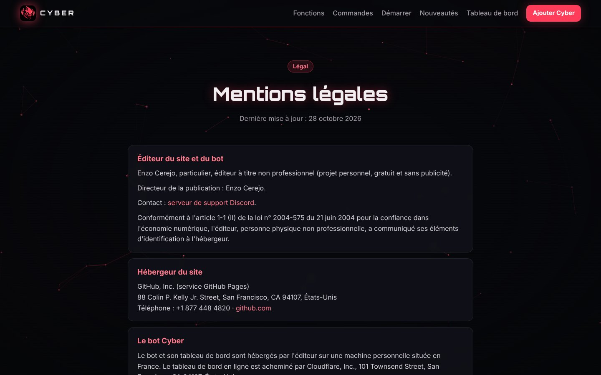

# Chapitre 9 · Données personnelles et vérification Discord

Un bot présent sur plus de 75 serveurs doit demander la **vérification** de Discord. Enzo voulait que tout soit en ordre avant : code, pages légales et réglages du portail.

## Ce que le bot a dû changer

| Avant | Après |
|---|---|
| Les données d'un serveur restaient pour toujours après le retrait du bot | **Effacement automatique 30 jours après le retrait** (annulé si le bot est réinvité). Vérifié aussi au démarrage, au cas où le bot était éteint au moment du retrait. |
| Aucun moyen pour un membre de voir ou d'effacer ses données | **`/mesdonnees voir`** : le membre reçoit en privé un fichier JSON avec tout ce que Cyber garde sur lui. **`/mesdonnees effacer`** : XP, scores de l'Académie, AFK, rappels et participations aux giveaways sont effacés sur tous les serveurs. Les avertissements restent aux modérateurs. |
| Sauvegardes du salon Discord sans limite | Seules les **7 dernières** sont gardées |

Règle de maintenance notée pour la suite : toute nouvelle donnée stockée doit être ajoutée au module `donnees.js` (export et effacement) **et** à la politique de confidentialité.

## Les pages légales du site

Réécrites après recherche sur le RGPD, la loi française (LCEN) et les règles de Discord :

- **Conditions d'utilisation** : service gratuit, règles d'usage, responsabilités, contact.
- **Politique de confidentialité** : liste précise des données, finalités, **bases légales**, durées de conservation, droits RGPD et comment les exercer (`/mesdonnees`), transferts hors UE (commande `/ia` traitée par Anthropic aux États-Unis, données gardées 30 jours chez eux), sous-traitants.
- **Mentions légales** (nouvelle page) : obligatoires en France (LCEN, article 1-1 II pour un éditeur non professionnel), avec l'hébergeur du site (GitHub).

Ces pages sont aussi déclarées dans le portail développeur Discord (Terms of Service URL et Privacy Policy URL), ce qui les affiche sur le profil du bot et dans la fenêtre d'invitation.

## Checklist de la vérification

| Étape | État au 28/10/2026 |
|---|---|
| Code conforme (`/mesdonnees`, purge 30 j) | ✅ fait et testé |
| Pages légales en ligne | ✅ (pull request #2 fusionnée) |
| Textes de justification des « intents » privilégiés | ✅ rédigés en anglais, prêts à copier |
| Application transférée dans une équipe Discord | ✅ (2FA obligatoire) |
| Double authentification sur le compte | à faire par Enzo |
| Vérification d'identité (Stripe, 16 ans minimum) | à faire par Enzo |
| Désactiver l'intent « Presence » s'il n'est pas utilisé | à faire par Enzo |
| Atteindre 75 serveurs pour pouvoir demander | en cours |

Deux champs du portail ont été laissés **volontairement vides** après explication : l'URL de vérification des rôles liés (Linked Roles, inutile ici) et l'URL du point de terminaison des interactions (si on la remplit sans serveur prévu pour, toutes les commandes cessent de répondre, car Cyber utilise la Gateway).
