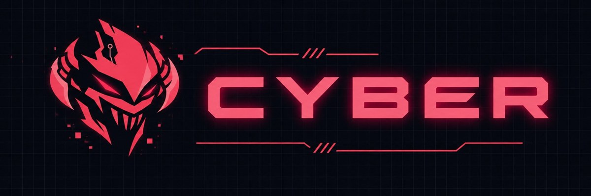
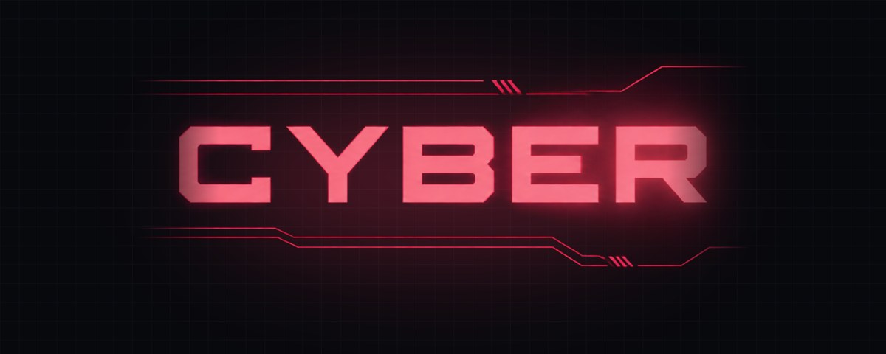
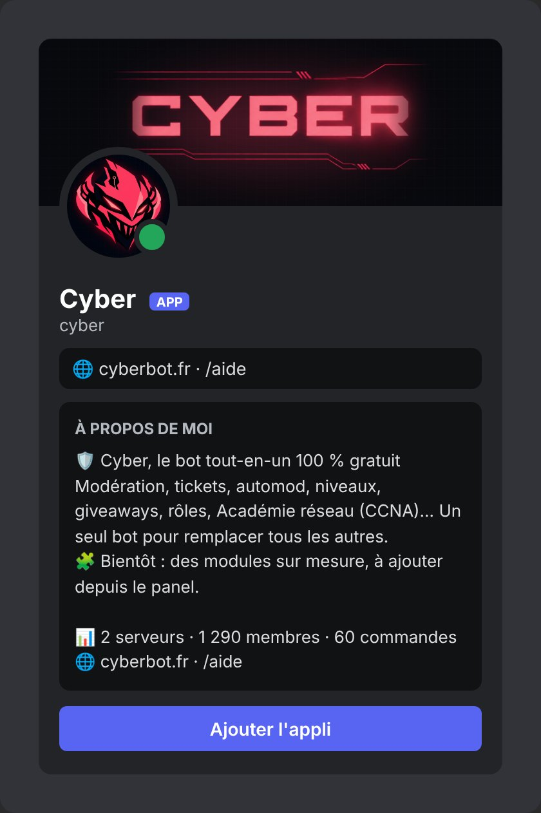

# Chapitre 10 · Identité visuelle et communauté

## La direction artistique

Le logo de Cyber est un **masque de démon cyberpunk rouge**, avec un petit tracé de circuit imprimé sur le front. Toute l'identité découle de ce masque.

| Élément | Valeur |
|---|---|
| Fond | `#08090D` (noir bleuté), surfaces `#12131A` |
| Rouge du bot | `#FF5A6E` (clair `#FF8A95`, profond `#FF3D5A`) |
| Accents rares | vert `#3DDC84`, bleu `#6C8CFF`, or `#FFC457` |
| Titres | **Orbitron** |
| Texte | **Inter** |
| Code | JetBrains Mono |
| Ambiance | « Console cyber » : grille fine de 32 px, halos rouges, circuits, léger glitch |

## Le pack de 57 prompts

Pour produire tous les visuels avec des IA d'images, un fichier de **57 prompts** a été rédigé : un « prompt 0 » qui fixe la charte (à coller en premier), puis un prompt par visuel avec sa taille finale :

- identité du bot : avatar, bannière de profil, logo horizontal ;
- serveur Discord : icône, bannière, fond d'invitation ;
- bandeaux d'embed par module (bienvenue, modération, niveaux, tickets, giveaways…) ;
- site et panel : image de partage (og:image), favicon, écran de connexion, page 404 ;
- pour plus tard : badges de niveau, icônes de rôles, bandeaux d'événements (maintenance, Noël, Halloween), widget de statut, réseaux sociaux, stickers.

Les générateurs gratuits sortent des images en 1024 ou 1536 px : chaque image est ensuite recadrée et redimensionnée aux tailles exactes demandées par Discord ou le site.

Quelques bandeaux d'embed déjà produits (1200 × 400) :

## Le profil du bot sur Discord

- **Avatar et bannière** chargés dans le portail développeur (la bannière a été refaite en version opaque, avec le texte centré, pour bien s'afficher en petite vue).
- **Statut permanent** : « 🌐 cyberbot.fr · /aide ».
- **Bio automatique** avec le nombre de serveurs, de membres et de commandes, mise à jour par le bot lui-même.
- Liens vers les conditions d'utilisation et la politique de confidentialité.
- Application transférée dans une **équipe Discord**.

## Le serveur Discord de support

Un modèle complet a été conçu pour le serveur officiel, dans le style « emoji + ・ » :

- **12 catégories, 35 salons, 15 rôles**, avec pour chaque salon qui le voit, qui peut y écrire et quelle commande de Cyber le fait fonctionner (tickets, bienvenue, giveaways, suggestions, défi du jour, niveaux, vocaux temporaires, logs, sauvegardes privées) ;
- `@everyone` ne voit que l'accueil tant qu'il n'a pas cliqué sur le bouton de `/verification`, qui donne le rôle Membre ;
- catégories Académie, Staff et **Bêta** (pour tester les futurs modules sur mesure), forum pour les bugs ;
- pas de catégorie « Sanction » : `/mute` utilise déjà le timeout natif de Discord.
